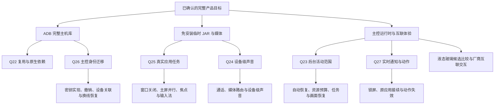

# 互联产品访谈与设计树

更新时间：2026-10-16（Asia/Shanghai）。状态：深入调研进行中；用户已将后续常规功能取舍交给代理，不再逐项询问是否需要。

## 最新范围收敛

本轮用户明确：不做录屏和文件／相册备份；短信以通知提醒，查看时进入被控手机原应用；通话、相册预览和文件管理可保留专用功能页。随后再次要求由代理参照成熟互联产品决定其余能力路由，不再逐项询问是否保留。

代理据此选择：保留跨设备文件／相册／通话任务；其他应用的完整阅读、编辑和设置由原应用接续；移除自动编辑回写、长期通知档案、专用相机页、硬件共享和开发者工具面板。截图、剪贴板及原通知已有快捷回复作为就近动作保留。具体清单与来源见[功能取舍](../../designs/prod/scope.md)、[小米与华为路由调查](../../docs/research/manufacturer-scope-xiaomi.md)。代理取舍不记成用户逐项确认。

此节及当前产品文档优先于下方历史访谈中已被替代的录屏、备份、短信原生服务和通知历史内容。此轮调整不等同于以“首版只做”缩减产品，也不改变 Rust ADB 独立完整主机库等既定技术约束。

**Q38 已确认：** 用户回答“是，打开远控画面即可”。“唤醒远控手机”指主控打开远控画面并进入手机原应用，不要求每次强制点亮被控手机的实体屏幕；实体屏幕沿用已有屏幕控制设置，需要解锁时呈现手机自身的解锁界面。

## 已确认的目标

- 面向普通用户，手机控制手机优先；按完整互联产品研究和规划，不以 MVP 或“首版只做”主动删除功能目标。
- 被控设备免安装 APK、无需 root，接受开启调试、首次授权和配对；允许经 ADB 临时运行并扩展 JAR。普通用户不应被要求理解 ADB 或输入命令。
- 当前功能目标包括投屏与输入、声音播放、截图、应用入口与独立应用窗口、文件和相册、剪贴板、实时通知及通话；短信完整处理进入原应用。录屏、备份及其他移除项见最新范围收敛。
- 保留设备信息与连接诊断；应用和系统设置进入手机原界面。本轮不建设独立应用管理、命令终端或日志查看器。
- USB、局域网无线、自动发现、配对、重连和可达跨网连接。跨网不预设自建云、账号或自动穿透。
- 多设备、多控制会话、多传输任务并行；手机支持切换/分屏，平板和桌面规划并排窗口。并行的具体资源约束尚需研究。
- 系统允许条件下提供后台保持、开关和断开入口。
- 按功能支持状态分级兼容；源码可行、文档支持与真机验证分开记录。被控端 Android 5+ 的基础投控目标不代表主控 App 也支持 Android 5。
- 默认低延迟优先，保留清晰度、帧率、码率、编码器及流畅/均衡/高清预设。
- monorepo、Rust ADB 主机库、flutter_rust_bridge、Flutter Hooks/Riverpod。Rust ADB 库独立于播放器和 Flutter。
- fvp 作为待验证候选，允许其底层 MDK 闭源依赖，媒体层可替换；是否能满足实际编码流接入和延迟要求尚未实测。
- Android 是当前功能实施和运行验证重点。Q32 补充四端实际可编译的交付要求；iOS、Windows、macOS 运行功能仍不要求当前全部验证。
- 设备优先：首页进入某台设备的屏幕、应用、文件、相册、通知和通话；短信经通知接续原应用。全局汇总传输任务，功能入口依据设备能力呈现。
- 液态玻璃、浅深色与跟随系统；玻璃主要用于导航、工具栏、控制浮层和弹出面板，内容区优先可读性；支持减少动态效果和降低透明度。
- Lucide 优先，确无合适图标再考虑 Iconify；遵循 Google DESIGN.md 格式与 designs/AGENTS.md。
- Pencil 绘制手机完整流程及平板、桌面关键布局。Pencil MCP 不可用时可用目录规则允许的 pen interactive；现已建立设计规范、共享组件及九类 39 个关键页面，见[用户流程与页面对应](../../designs/prod/user-flows.md)。
- 文件同名冲突默认询问保留两份/替换/跳过，可应用于当前传输任务后续冲突（Q21）。
- 手机控手机不引入“查看模式”（Q20）；按成熟互联产品重新研究操作方式。触控板未获得确认，不作为已定功能。
- ADB 依赖链尽量纯 Rust（Q22）；这是明确偏好，具体纯度口径和例外仍待查明。用户没有接受默认 C/C++ 后端，也没有要求所有协议实现必须从零编写。
- 后台按活动类型保持（Q23）：连接、通知与传输继续，不可见视频暂停；主动后台声音继续，回前台恢复画面。Q23 原回答中的录屏活动已随最新范围移除。
- 声音按设备管理（Q24）：同一手机只接收播放一次；多台手机默认选定单路，可固定音源并主动开启混音。
- 独立应用窗口接续真实任务和登录态（Q25），单实例迁移时说明，多实例按实际能力提供。
- 主控授权身份默认不自动迁移（Q26）；换机/重装重新授权，设备名称和偏好可单独恢复。
- 默认实时通知同步；断线标记状态，旧动作与回复重新验证连接和通知有效性。Q27 原接受的可选通知历史已由本轮授权下的代理取舍移除，不再建设长期档案。
- Q28 的能力与默认交回工程依据 scrcpy 决定：官方支持关闭虚拟显示时销毁其中内容，也支持迁回主屏；与强制停止整个包分开，不再要求用户回答能力事实。当前产品默认由代理依据后续授权选择保留任务并迁回主屏，不记为用户对 Q28 的偏好确认。
- 按中断原因和操作类型恢复（Q29）：短暂断线恢复连接和持续任务，尊重主动停止；可能已执行且结果未知的副作用先查询或提示，不一律重放。
- 实时通知操作同步被控设备（Q30）：清除、点击、快捷回复按远端实际动作处理，本地历史独立。
- 资源不足时保护已有通话和当前操作（Q31）：优先降新窗口及非焦点负载，仍不足则明确让用户选择，不静默终止重要活动；原录屏资源规则不再适用。
- 四端编译是依赖与架构的验收要求（Q32）：Android、iOS、Windows、macOS；用户未确定更严格纯 Rust 定义，未自动接受原生密码后端。当前尚未实际构建四端。
- 主控始终不要求开启调试（Q33），不提供本机 ADB 增强入口。主控剪贴板等能力必须基于普通应用权限与实际平台限制设计。
- 自动剪贴板同步默认跟随当前操作设备并可固定对象（Q34）；其他后台设备不自动覆盖主控剪贴板，主动发送可选择指定设备。
- Q35 后用户明确要求参照已有厂商互联产品自行取舍后续功能，不再为常规功能逐项询问。工程与产品默认需写明依据，不能把代理选择伪装成用户逐项确认。

## 调研树与剩余验证

已答规则与后续代理默认不再进入同义问卷；研究任务按依赖推进。

| 分支 | 已定内容 | 尚需工程证据 |
| --- | --- | --- |
| ADB完整度与无线 | 独立完整Rust主机库、无外部adb | API账本、固定参考版本、Wi-Fi2与旧版互操作；任务01 |
| 依赖与身份 | 尽量纯Rust、四端构建、身份不自动迁移 | 密码成熟度、feature闭包、signer与多路径关联；任务02/03/15 |
| 服务端与应用 | 临时JAR、真实task、单实例说明、默认关闭保留迁回 | 协议、清理、并发、输入/焦点和异常恢复；任务06/08 |
| 媒体与声音 | fvp初选、低延迟、设备级单路可固定/混音 | PTS/渲染、路由、通话HAL及资源预算；任务07/12/13/16 |
| 后台与恢复 | 按活动保持、主动停止保持停、未知操作不重放 | FGS/系统回收/重启与端点恢复资格；任务09/14 |
| 内容与消息 | 文件相册通话专页，短信等原应用接续 | 文件部分失败、视频预览、通知有效性/认证/回执；任务09/10/11 |
| 普通用户与交互 | 手机优先、主控不调试、直接控制无查看模式 | 首次授权下限、扫码/手动连接、中文IME与厂商流程；任务05/08/17 |
| 设计与验收 | 黑色主题默认浅色、分组行、独立页面、Google规范 | 覆盖表缺失状态、动态玻璃/可访问性、Android基准；任务16/18/20 |

统一入口：[需求审计](requirements-audit.md)与[任务索引](issues/README.md)。严格纯度/原生密码例外尚未获用户统一定义；先交实际闭包、成熟度和可替代证据，不反复要求用户选算法。

## 调研资料

- [ADB 主机与连接](../../docs/research/adb-host-and-connectivity.md)
- [纯 Rust ADB 依赖链](../../docs/research/pure-rust-adb-dependencies.md)
- [四端编译交付约束](../../docs/research/cross-platform-build-contract.md)
- [厂商互联完整流程](../../docs/research/manufacturer-workflows.md)
- [scrcpy、媒体与服务端](../../docs/research/scrcpy-media-and-server.md)
- [Flutter、Rust 与平台运行时](../../docs/research/flutter-rust-platform-runtime.md)
- [设计系统与 Pencil 工具链](../../docs/research/design-system-and-toolchain.md)
- [手机输入与剪贴板](../../docs/research/mobile-input-and-clipboard.md)

专项调研见[调研索引](../../docs/research/README.md)，区分源码事实、工程推论与未执行 POC。完成文档调查不等于工程方案已通过验证。

## 最新一轮结果与待查分支

- Q19 未决定：用户要求先比较其他液态玻璃库，不能只研究 liquid_glass_renderer 就要求接受降级。补查 liquid_glass_easy、liquid_glass_widgets 等的跨端依据与视频背景采样路径。
- Q20 已否决查看模式：用户强调互联产品的成熟交互，不采用远程查看器的模式切换方案；继续对照厂商产品。
- Q21 已确认：同名文件默认询问保留两份/替换/跳过，可应用于当前任务后续冲突。

研究仍在进行；具体玻璃库与完整交互方案尚未冻结。

## Q22–Q27 结果与后续分支

| 问题 | 用户答案 | 已解锁但尚未决定的分支 |
| --- | --- | --- |
| Q22 Rust 重写的约束 | 希望尽量做到整个 ADB 依赖链纯 Rust；没有接受原推荐的默认原生依赖 | TLS/USB/压缩实现、纯 Rust 口径、候选复用与例外策略 |
| Q23 后台活动范围 | 确认按活动类型保留 | 自动恢复、耗电策略、Surface/编码器重建、任务恢复 |
| Q24 多窗口声音 | 确认设备级单路默认，可固定与主动混音 | 通话/媒体优先级、双端发声与蓝牙路由；录制分支已移除 |
| Q25 应用任务语义 | 确认接续真实任务与单实例迁移说明 | 关闭窗口、主屏并行、焦点/IME、任务迁回或销毁 |
| Q26 主控身份迁移 | 确认身份不自动迁移，元数据可恢复 | signer/Keystore、逐设备密钥、显式导入、撤销及多连接归并 |
| Q27 通知历史 | 确认实时默认、历史可选、动作重验证 | 后续长期历史已移除；只保留锁屏展示、清除/回复与失效动作验证 |

## Q28–Q31 结果

| 问题 | 用户答案或处理方式 | 后续 |
| --- | --- | --- |
| Q28 应用窗口关闭 | 用户要求看 scrcpy 能力；已核实销毁内容和迁回主屏均支持，默认与设置由工程按互联体验设计 | 不把用户答复误记为接受“默认迁回”；区分 task/display 结束和 force-stop package |
| Q29 恢复分级 | 确认按中断原因和操作类型恢复 | 需实现错误分类、任务结果核对及主动停止意图 |
| Q30 通知动作 | 确认实时动作同步被控设备 | 需远端动作权限与有效性验证，本地历史独立 |
| Q31 资源争用 | 确认保护已有重要活动，明确处理不足 | 需实际资源预算与可解释的降载/暂停选择 |

### 补查完成的事实分支

- 纯 Rust ADB：已核查候选源码的 TLS/USB/压缩依赖路径。nusb 与双向纯 Rust 压缩存在候选；TLS provider 成熟度仍需解决。尚未运行 Cargo 解析目标依赖闭包或实际构建；还未决定系统 API 调用的纯度口径或原生例外。
- 手机输入与剪贴板：已核查普通主控后台权限、软键盘 composing 与 UHID、图片/文件 URI 授权，并补查本机无线 ADB。后者存在一手实现，但需要主控额外开启调试，后续已被 Q33 明确否决，不进入产品方案；不恢复已否决的查看模式。

这些分支继续由技术证据和验证收敛；Q35 后不再把普通功能默认逐项交回用户。

## Q32–Q34 结果

| 问题 | 用户答案与决定 | 后续 |
| --- | --- | --- |
| Q32 纯 Rust 的验收口径 | 用户不确定更严格定义，但明确要求确保全平台编译 | 四端构建成为验收要求；尚未构建，也未批准原生密码库例外 |
| Q33 可选主控增强功能 | 否决：主控始终不要求开启调试 | 不提供本机 ADB 增强入口；主控普通权限下的剪贴板体验继续研究 |
| Q34 多设备剪贴板对象 | 确认跟随当前设备并可固定 | 其他设备不自动覆盖，主动发送指定对象；运行能力按平台权限提供 |

Q32 的跨平台编译要求已补入 ADR 0002；Q33 的授权边界见 ADR 0006。Q34 的同步对象语义已加入词表。系统密钥、密码学依赖及完整输入体验未因此冻结。

## Q35–Q37 回答与授权范围调整

| 问题 | 用户答复／处理 | 后续 |
| --- | --- | --- |
| Q35 跨设备编辑回写 | 用户要求调研已有互联产品，后续功能自行取舍 | 由代理基于厂商流程、权限和可验证性确定产品范围与默认 |
| Q36 相册快速取用与备份 | 没有单独作答；已被上述功能取舍授权覆盖 | 不再等同一问题的确认，由代理选择并记录依据 |
| Q37 本机内容接续 | 用户不确定，要求查 scrcpy 最新版启动单应用的能力 | 已核实最新稳定 5.0.1；应用互联主线采用远端指定应用启动与虚拟显示，本机打开内容作为独立便利动作评估 |

此后不继续批量询问“某功能是否需要”。已有明确约束持续有效；能力事实由代理查证，常规范围和默认由代理取舍并沉淀至 spec。通知／短信／通话的免 APK 权限链继续调查，技术未知不当成用户尚未作出的产品决定。

## 设计树的主要依赖

箭头表示前提，不表示实现顺序或功能删减。未确认节点继续保持开放。

## 本轮规则

### 最新视觉要求

- 页面按功能类型分类，一类一行；每页独立，同类状态相邻，不按旧编号机械铺排。
- 依据 Apple 官方 Liquid Glass 的材质与交互理念重设计，内容与导航／控制层分开。
- 黑色和中性色作为主题色，**默认浅色外观**。用户明确纠正：黑色主题色不等于默认深色模式；深色只保留为可选外观。
- 最新反馈要求加强液态玻璃的透色与层次；图标、小元素允许非中性色点缀，不能把中性主题理解为全部灰色。用户明确否定深绿色按钮；本轮接听改为浅薄荷玻璃配深色文字，拒接使用浅珊瑚玻璃，主动作保持黑色。
- 已将上述要求落实到九类 39 个页面，产品范围与页面对应见 designs/prod；静态设计不作为运行能力验证。

### 移动端全屏远控纠正

用户明确要求移动端远控完全全屏，像直接使用被控手机；全屏保留可拖拽、吸附侧边隐藏的悬浮退出按钮。本轮移除整机控制、通知接续和移动端独立应用的主控页头/外置工具栏，补画拖拽与左右收起状态。收起露出把手，点击展开再退出；退出回到工作台且不停止其他活动。屏幕比例、系统手势、键盘、旋转与触摸隔离仍由任务08验证。

使用 grilling + domain-modeling：事实由调研确认；用户明确保留的选择由用户决定，Q35 之后已授权的常规功能取舍由代理负责。问题按前提依赖分轮提出，不把技术调查和默认设计反复交回用户。先前的“结束访谈”不代表架构或完整规格已冻结；能力证据、代理决定及实际验证结果分别记录。

### 全屏遗漏状态纠正

用户指出zLQT5仍将手机作为方块画面。检查发现上一轮漏掉重连、画质声音和资源不足三个共用旧底层的状态；本轮统一全屏底层，保留悬浮退出，并将工作台、会话列表的横向裁切预览换为状态卡。全屏验收必须覆盖叠加面板和异常状态，不能只覆盖正常入口。

### Pencil组件复用要求

用户要求善用Pencil组件能力。已将重复远控底层整理为共用全屏会话，展开/侧边退出、桌面/原应用、面板外壳与五类内容以及系统状态栏/手势均以母组件和连接实例表达。页面只覆盖文案、位置和显隐等状态；需要验证母组件修改确实传递到实例，保存后状态与引用仍保留。

## 设备首屏与连接页面纠正（2026-10-16）

用户明确：产品没有备用手机概念；首屏应为设备列表；缺少设备连接表单及其他必要页面，要求完整分析、优化当前相关页面，完成后分批提交。

本轮执行：固定设备列表，平等设备卡和空／检查／全离线／搜索状态；补齐设备管理、连接方式、发现、地址与端口、配对／二维码、两端USB授权、配对后连接和失败恢复。进一步补文件目录与管理、部分成功、视频、通知异常、画质选项、音源／剪贴板、后台、多来电及外观。当前77页、十二类分行、23母组件；仍未绘制或验证的状态公开保留在prod/coverage.md，不冒称应用已实现。用户授权按主题分批Git提交，未要求推送。
