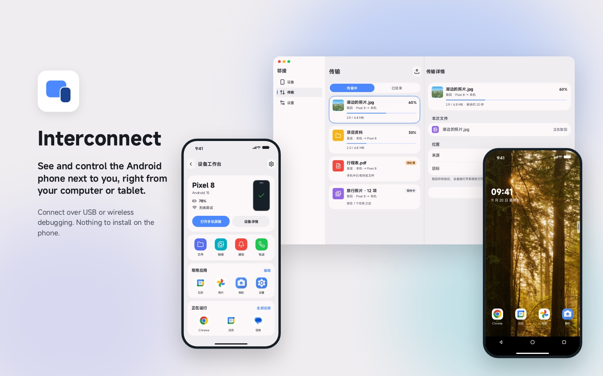
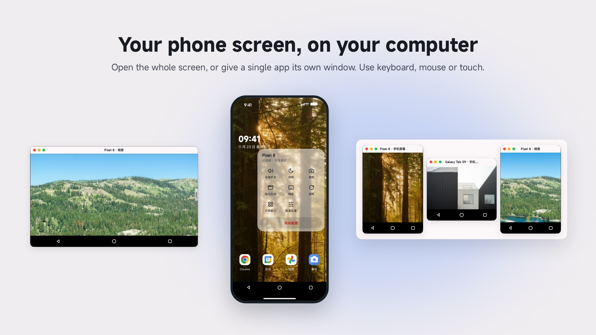
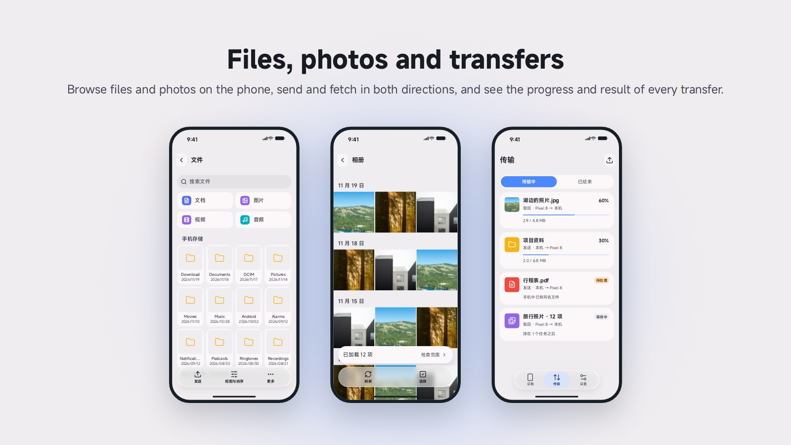
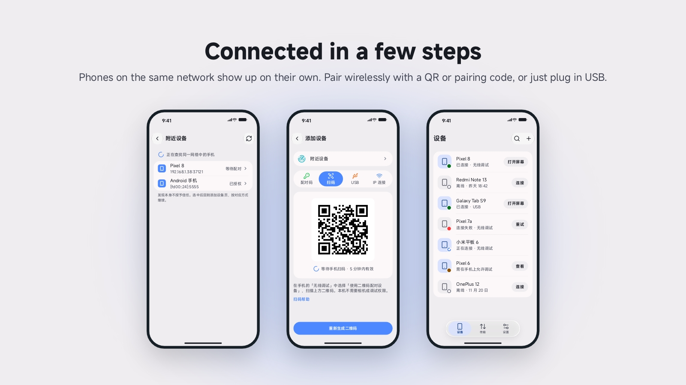

<p align="right"><a href="README.md">简体中文</a> · English</p>

# Interconnect · 邻接



Interconnect lets you see and control the Android phone next to you from a computer, a tablet or another phone. Connect over USB or wireless debugging, then open the phone's screen, browse its files and photos, and move files in both directions. Nothing needs to be installed on the phone: Interconnect uses Android's built-in debugging authorization.

> The app's interface is currently in Simplified Chinese only.







## What it does

- **Phone screen**: open the whole screen in a window and use keyboard, mouse or touch. You can also give a single app its own window.
- **Files and photos**: browse files and photos on the phone, send and fetch them, and see the progress and result of every transfer.
- **Connecting**: phones on the same network show up on their own. Pair wirelessly with a QR code or pairing code, or just plug in USB.
- **Many hosts**: Windows, macOS, Linux, Android, iOS and iPadOS can all control a phone. What each platform supports is listed in [Platforms and capabilities](designs/prod/compatibility.md) (Chinese).

## Download

Get it from [GitHub Releases](https://github.com/xiankq/scrcpy-connect/releases). Current builds are previews.

| Platform | Which file |
| --- | --- |
| Windows | The x64 or ARM64 installer `.exe`. To skip installing, download the `.zip`, extract all of it and run `Interconnect.exe` |
| macOS | The Apple silicon or Intel `.dmg`; drag Interconnect into Applications. Preview builds are not notarized, so allow the app once under System Settings › Privacy & Security |
| Linux | x64 or ARM64 AppImage, DEB, RPM or tar.gz |
| Android | The APK for your CPU; if unsure, `android-universal.apk` |
| iOS / iPadOS | Preview builds run in the simulator on an Apple silicon Mac. Installing on a device requires your own signing |

Desktop builds include ADB, so there is nothing else to install.

## First connection

1. On the Android phone, turn on Developer options.
2. Turn on USB debugging for a cable, or Wireless debugging for Wi-Fi.
3. In Interconnect, tap Add device (添加设备) and follow the prompts to plug in, scan the QR code or enter the pairing code.
4. When the phone asks for authorization, only allow computers you trust.

## Run from source

You need Flutter 3.50.1, the Rust toolchain pinned in `rust-toolchain.toml`, Node.js 22 and Python 3. Android builds also need JDK 21 and the Android SDK; desktop builds need the platform's native toolchain.

```sh
export PUB_HOSTED_URL=https://pub.flutter-io.cn   # the lock file pins this mirror
flutter pub get --enforce-lockfile
cd app
flutter run -d <device>
```

Build dependencies, checks and the contribution workflow are in [CONTRIBUTING.md](CONTRIBUTING.md) (Chinese).

## Layout

The Flutter app is in `app/`. Reusable Dart APIs are in `packages/`, backed by Rust in `rust/`. Components that run temporarily on the phone are in `servers/`.

## Feedback

Please [open an issue](https://github.com/xiankq/scrcpy-connect/issues) for bugs and ideas. Report security problems privately as described in [SECURITY.md](SECURITY.md).

## License

The code is under the [MIT License](LICENSE). Third-party components and design assets keep their own licenses; see [THIRD_PARTY_NOTICES.md](THIRD_PARTY_NOTICES.md).
