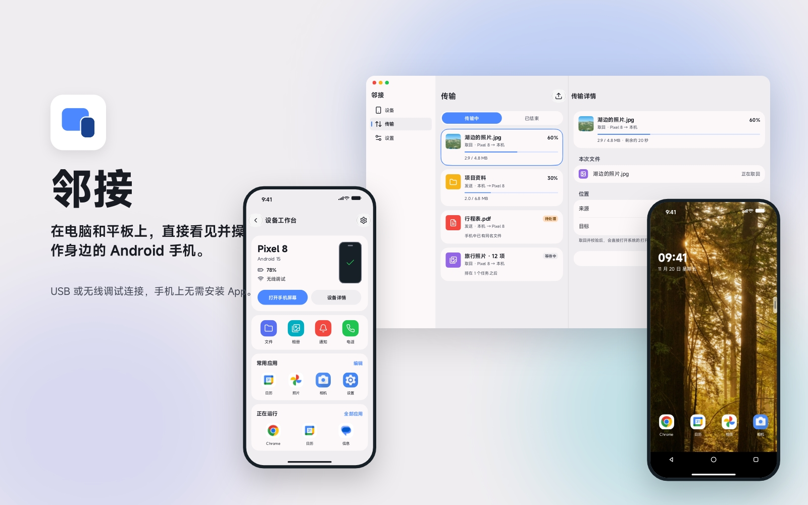
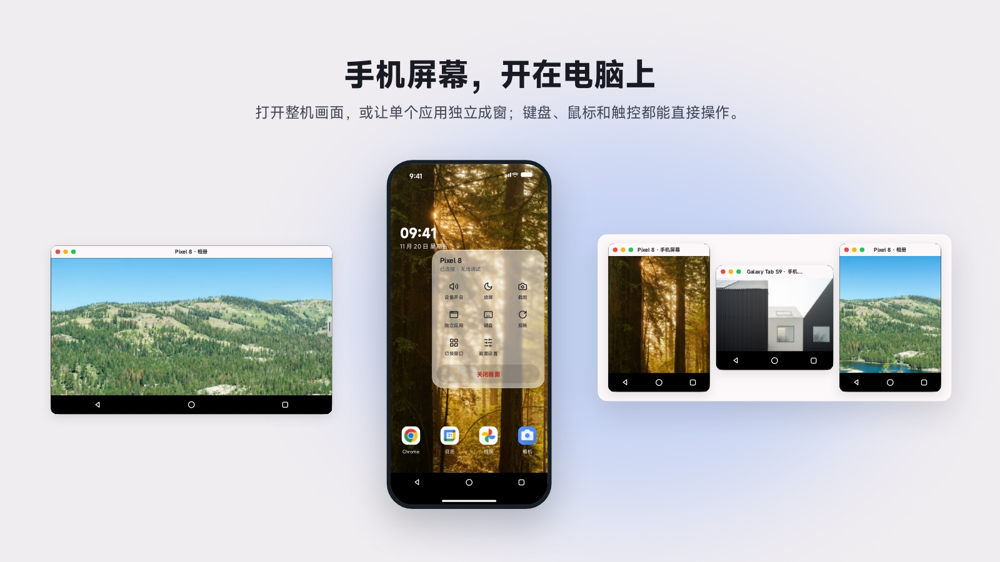
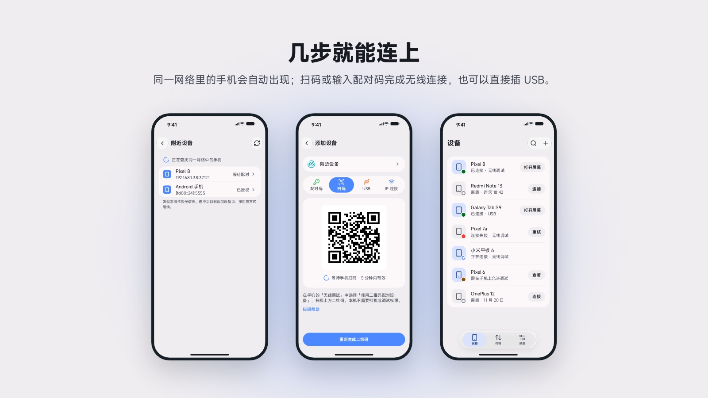

<p align="right">简体中文 · <a href="README.en.md">English</a></p>

# 邻接 · Interconnect



邻接让你在电脑、平板或另一部手机上，直接看见并操作身边的 Android 手机。用 USB 或无线调试连上之后，可以打开手机屏幕、管理文件、浏览相册、收发文件。手机上不需要安装任何 App，用的是 Android 自带的调试授权。






## 能做什么

- **打开手机屏幕**：整机画面开在窗口里，键盘、鼠标、触控都能操作；也可以把某个应用单独开成一个窗口。
- **文件与相册**：浏览手机里的文件和照片，在两边之间发送、取回，每个任务都能看到进度和结果。
- **连接**：同一网络里的手机会自动出现；扫码或输入配对码即可无线连接，也可以直接插 USB。
- **多平台**：Windows、macOS、Linux、Android、iOS 和 iPadOS 都能当主控。各平台支持的功能见[平台与能力](designs/prod/compatibility.md)。

## 下载

到 [GitHub Releases](https://github.com/xiankq/scrcpy-connect/releases) 下载。当前是预览版。

| 平台 | 选哪个文件 |
| --- | --- |
| Windows | x64 或 ARM64 的安装器 `.exe`；不想安装就下载 `.zip`，完整解压后运行 `Interconnect.exe` |
| macOS | Apple 芯片或 Intel 的 `.dmg`，把「邻接」拖进「应用程序」。预览版未经 Apple 公证，首次打开需要在「系统设置 › 隐私与安全性」里允许 |
| Linux | x64 或 ARM64 的 AppImage、DEB、RPM 或 tar.gz |
| Android | 按 CPU 架构选 APK；不确定就下载 `android-universal.apk` |
| iOS / iPadOS | 预览版只能在 Apple 芯片 Mac 的模拟器里运行；真机安装需要自行签名 |

桌面版自带 ADB，不用另外安装。每个文件的详细区别见[下载包说明](docs/releasing.md)。

## 第一次连接

1. 在被控的 Android 手机上打开「开发者选项」。
2. 用 USB 连接就打开「USB 调试」；无线连接就打开「无线调试」。
3. 在邻接里点「添加设备」，按提示插线、扫码或输入配对码。
4. 手机弹出授权提示时，只授权你信任的电脑。

连接、配对、重连的区别见[设备连接](designs/prod/device-connection.md)。

## 从源码运行

需要 Flutter 3.50.1、`rust-toolchain.toml` 指定的 Rust、Node.js 22 和 Python 3。编译 Android 还需要 JDK 21 和 Android SDK；编译桌面版需要对应系统的原生编译工具。

```sh
export PUB_HOSTED_URL=https://pub.flutter-io.cn   # 使用锁文件里的 Pub 镜像
flutter pub get --enforce-lockfile
cd app
flutter run -d <设备>
```

各系统的构建依赖、检查命令和提交流程见[贡献指南](CONTRIBUTING.md)。

## 文档

| 文档 | 内容 |
| --- | --- |
| [产品规格](designs/prod/README.md) | 每个页面和功能应该怎么表现 |
| [视觉规范](designs/design.md) | 颜色、字体、控件和布局 |
| [构建脚本](scripts/README.md) | 本机检查、构建、打包和清理缓存 |
| [发布流程](docs/releasing.md) | 从试打包到公开发布 |
| [变更记录](CHANGELOG.md) | 每个版本的变化 |
| [第三方组件](THIRD_PARTY_NOTICES.md) | 随附的外部代码、素材和许可 |

目录：Flutter 应用在 `app/`；可复用的 Dart 接口在 `packages/`，对应的 Rust 实现在 `rust/`；在手机上临时运行的组件在 `servers/`。

## 反馈

问题和建议请[提交 issue](https://github.com/xiankq/scrcpy-connect/issues)。安全问题请按[安全报告](SECURITY.md)私下提交。

## 许可

项目代码使用 [MIT 许可证](LICENSE)。外部组件和设计素材沿用各自的许可，见[第三方组件](THIRD_PARTY_NOTICES.md)。
