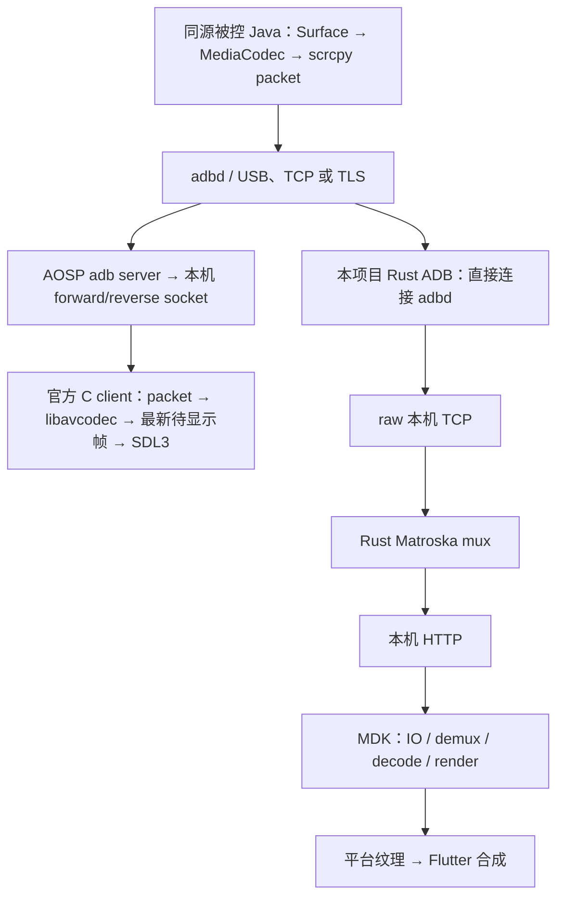
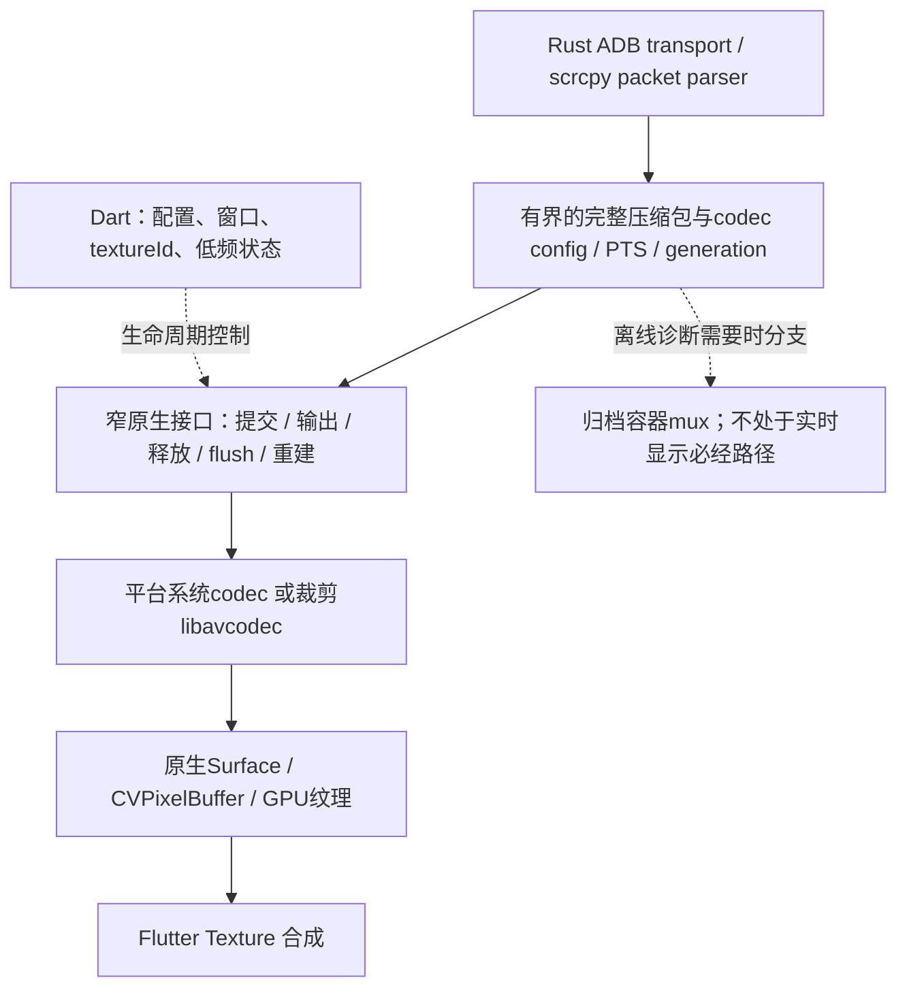

# scrcpy 主控核心的体积、延迟与跨平台重构评估

核查日期：2026-10-23。源码基线为工作区 HEAD `1bbcbcd8eba368e3c361f3e05aaff780733f039e`，包含核查时已有未提交改动；产物另按摘要标识。本轮只读源码、依赖、现存构建产物和上游一手资料，没有修改实现、构建替代方案、部署设备或新增性能实验。本文是研究建议，不改变当前 ADR、产品支持范围或工具链规则。

## 决策结论

**值得重构的是实时媒体路径；现有证据不支持先推翻 Rust 或自写 ADB。** 建议的长期方向是：保留 Flutter 产品界面和 Rust 的连接、身份、会话与压缩包所有权；让 scrcpy 完整压缩包通过窄的原生接口直接进入平台解码器，输出原生 Surface／纹理；用裁剪 libavcodec 承担确有需求的软件兼容路径。统一包与生命周期契约，各平台分别实现解码和纹理互操作。

这条路线有同时缩小依赖范围、缩短输入路径和改善诊断的结构性理由，但**没有完成四端实测，不能承诺重构后多少毫秒或多少 MiB**。现存证据支持以下优先级：

1. 先处理生产实际采用实验性 TLS provider 的维护风险，并补齐实际 codec／队列观测。
2. 对照原生 packet 解码、当前 MDK 和裁剪 libavcodec，先在物理 Android ARM 主控验证收益。
3. 如果收益成立，替换远控视频、PCM 输出和仍依赖 fvp 的桌面相册预览，最终移除整套通用播放器依赖。
4. 对 ADB 只改经测量确认的 ACK 调度、窗口、USB 缓冲路径；是否改语言单独决策。

**不推荐把 media_kit 全量迁移作为“小包体＋极低延迟”的默认答案。** 它的明确价值是 libmpv 核心源码可见、可自行修复；默认接法仍是通用播放器的字节流输入，包体与时延优势没有本项目证据。[既有替换核查](fvp-media-kit-comparison.md)、[mpv 字节流回调 API](https://github.com/mpv-player/mpv/blob/master/include/mpv/stream_cb.h)

## 比较范围与证据身份

| 对象 | 本轮使用的身份 | 能证明的范围 |
| --- | --- | --- |
| 本项目源码 | 上述 HEAD＋已有工作区改动，fvp 0.39.1 | 当前可见实现及静态机制；不是全平台运行结果 |
| 被控 scrcpy | 5.0.1，源码 `a60891aea193d92e7e5c3942700eca63f9d19a5f` | 原 Java 源码经本仓库 desugaring 构建，不能与官方 release JAR 字节混同 |
| 官方主控 | 同一 scrcpy 5.0.1 源码 | 桌面 Linux／Windows／macOS；没有官方 Android／iOS client 的交付承诺 |
| AOSP ADB 对照 | `9084198a2d4b0f6a0f174260fb42da33485b684d` | 固定参考实现，不代表所有被控系统内置 adbd 完全相同 |
| 现存最近 release APK | SHA-256 `55d29211eec0f903294045cf09add3b3e95350bcb370c4d75b05c94dc9826196` | 本文包体审计；不能绑定当前 dirty 工作树的全部代码 |
| 历史性能 | 仓库 10/18～10/22 的 AVD／主机实验 | 只沿用对应环境和计时边界，不作为真机四端性能保证 |

产品主控范围是 **Android、iOS、macOS、Windows**；Linux 有开发及播放器接入，本报告将其作为扩展设计对象，不能写成已交付第五端。iOS USB、后台限制、系统权限不会随播放器或编程语言更换而消失。[平台规格](../../designs/prod/compatibility.md)、[ADR 0002](../adr/0002-rust-adb-and-flutter-monorepo.md)、[构建与实际验证边界](../implementation/validation.md)

当前官方 release 5.0.1 修复了 Linux VA-API、多 GPU 和 Windows HEVC 硬解问题；**该版本默认尝试硬解，失败回退软件**。不能继续用“原版 scrcpy 只有软件解码”作比较前提。[官方 release](https://github.com/Genymobile/scrcpy/releases/tag/v5.0.1)、[固定版本视频文档](https://github.com/Genymobile/scrcpy/blob/a60891aea193d92e7e5c3942700eca63f9d19a5f/doc/video.md)

## 当前与官方的真正差别

官方也存在 ADB server、本机 socket、线程、队列和数据复制。本项目直连 adbd 省去了它的一部分宿主跳转；随后为了适配通用播放器，又添加了 raw TCP、容器封装和 HTTP。不能只按 Rust／C++ 或函数层数比较延迟。[官方 adb 调用与 tunnel](https://github.com/Genymobile/scrcpy/blob/a60891aea193d92e7e5c3942700eca63f9d19a5f/app/src/adb/adb.c#L216-L309)、[forward/reverse 策略](https://github.com/Genymobile/scrcpy/blob/a60891aea193d92e7e5c3942700eca63f9d19a5f/app/src/adb/adb_tunnel.c#L124-L144)、[本项目完整数据路径](scrcpy-fvp-copy-path.md)

| 维度 | 官方 scrcpy 5.0.1 | 本项目 | 评估 |
| --- | --- | --- | --- |
| 被控采集、编码 | Java Surface／MediaCodec | 同源官方 Java；会话参数由 Rust 传入 | 主体相同，不存在一次额外的视频重编码 |
| ADB 主机 | 外部 adb client＋AOSP adb server | 进程内 Rust 直接访问 adbd | 我们集成更紧；AOSP 有更广的宿主和设备维护积累 |
| 压缩包到解码 | 协议给出完整包边界，直接 submit／drain | 重封 Matroska 后由 MDK 读流和 demux | 我们有可去掉的容器、I/O、分配及调度边界 |
| 解码延迟意图 | LOW_DELAY；默认不插额外 video regulator | AMediaCodec async 等优先级、FFmpeg slice、video ASAP | 两边均已做低延迟配置；实际执行与输出等待仍需观测 |
| 待显示帧 | 新 decoded frame 可覆盖旧 pending frame | MDK renderer 队列设1，live GOP 丢弃策略 | 我们受 SDK 的输入／解码／renderer 内部语义约束更多 |
| 输入 | 独立发送／接收线程、有界控制队列 | Dart／Rust move 合并、有界录取、批写及 priority writer | 我们已消除旧版逐事件等待网络 ACK 的入口；仍有调度差异 |
| 媒体依赖 | SDL3、FFmpeg 及平台硬解适配 | Flutter＋MDK＋FFmpeg＋fvp | Flutter 承担完整产品界面，MDK 的通用播放能力与专用远控有重叠 |
| 移动宿主、多设备产品 | 官方以桌面镜像工具为主 | 原生授权、身份、多会话、内容、恢复等产品责任 | 原版不能作为整个库的等价替换 |

官方媒体事实见 [demuxer](https://github.com/Genymobile/scrcpy/blob/a60891aea193d92e7e5c3942700eca63f9d19a5f/app/src/demuxer.c)、[decoder](https://github.com/Genymobile/scrcpy/blob/a60891aea193d92e7e5c3942700eca63f9d19a5f/app/src/decoder.c)、[frame buffer](https://github.com/Genymobile/scrcpy/blob/a60891aea193d92e7e5c3942700eca63f9d19a5f/app/src/frame_buffer.c)。本项目对应 [scrcpy.rs](../../crates/interop_core/src/scrcpy.rs)、[视频适配器](../../packages/interop_bridge/lib/src/media/fvp_video_player.dart)、[输入队列](../../app/lib/pages/devices/workspace/remote/remote_input_queue.dart)。

功能对齐也要遵守产品边界：本项目明确移出了录屏、虚拟摄像头／麦克风共享等范围，因此这类与桌面工具的差异不登记为实现缺陷，也不为复刻全部CLI功能重新引入依赖。仍应优先补的是已承诺远控的低延迟、解码兼容、真实声音输出与恢复证据。[产品范围](../../designs/prod/scope.md#移出产品范围)

### 已确认的媒体缺口与尚不能归因的性能问题

**压缩流侧有冗余，像素侧不能混算。** 默认 H.264 路径从 ADB payload 已在主控内存起，可确认5个 Rust 用户态整包数据复制阶段；USB 接收适配另有3个阶段。另有两段本机 TCP 的内核搬运、MDK 内部处理和平台 GPU 工作。Dart 正常播放只传 URL、配置和 textureId，没有每帧压缩包或 RGBA 经 MethodChannel 往返。[逐项复制证据](scrcpy-fvp-copy-path.md)

以默认4Mbps视频估算，压缩数据约0.5MB/s，5次复制约2.5MB/s有效数据搬运；这与1080p、RGBA、60fps约498MB/s的单次完整像素流量不是同一数量级。前者仍有分配、系统调用和唤醒成本，但不能靠“5次复制”直接解释数百毫秒。分辨率只是数量级举例，不代表当前实际输出1080p。

**更强的既有反证是同输入更换后端。** 10/19 在 Android16 x86_64 AVD、相同H.264录像、PTS和供数节拍下：

| 输入与后端 | 输入进入 → MDK onVideo 的 P95 |
| --- | ---: |
| HTTP，MDK AMediaCodec async | 约163ms |
| append，MDK AMediaCodec async | 约163ms |
| HTTP，FFmpeg slice，后续四轮组中位数 | 1.757ms |
| append，FFmpeg slice，同组 | 1.683ms |

这把该环境的主要等待缩小到 AMediaCodec／MDK 解码输出边界，否定了“94ms就是HTTP传输成本”的解释。它没有分开系统 codec 完成、MDK 取出与交帧，也没有证明物理 ARM 同样慢；录像约381帧／36.35秒，不能外推成60fps固定增加94ms，更不能把1.7ms当面板延迟。[实验完整方法与结果](mdk-memory-input-experiment.md)、[容器／parser／线程的反证](scrcpy-client-latency-path.md)

**MDK 内部不可见会增加定位成本。** 当前读流、demux、codec提交／取出和 renderer 调度不能全部由公开源码追踪；可选 ABI 解码接口不在 fvp 稳定 C API 中。现有自有快照读取避开了 fvp 的空结果路径，但 native 销毁确认仍有边界，不能把 Dart dispose 返回当实际资源删除。[MDK 接入边界](cross-platform-media-pipeline.md)、[fvp 与生命周期核查](fvp-media-kit-comparison.md)

**现有平台显示有额外 GPU 工作。** fvp Windows 插件显式 `CopyResource`，Apple 插件显式 Metal blit；Android 当前没有打开 fvp 的 directSurface `tunnel=true` 分支。不能据此宣称打开 tunnel 就会更快或没有兼容代价，也不能把 GPU blit 当每帧 CPU memcpy。[固定插件证据](scrcpy-fvp-copy-path.md#主控-dart-与-fvp-原生连续播放只传控制信息)

### 自写 ADB 的差异与真实风险

现有 ADB 并非仅实现连接和 shell：包含 AUTH、无线配对／TLS、USB、服务流复用、SYNC、reverse、取消和有界流控。默认支持库 burst 关闭，产品默认请求，只有双方协商后生效；现代 endpoint 使用 Required TLS。把缺少完整桌面 adb CLI 或5037服务器当作远控缺陷，比较对象就错了。[ADB 库契约](../../crates/adb/README.md)、[产品 ADR](../adr/0002-rust-adb-and-flutter-monorepo.md)

旧研究中的 SYNC 逐记录 RTT、现代协议仍算 checksum、reader 等待已满普通 writer 等问题，当前已有对应修改，不能重复登记为现存缺陷。[历史报告及基线声明](adb-reference-performance.md)、[当前 writer／reader](../../crates/adb/src/client.rs#L358)、[checksum 分支](../../crates/adb/src/protocol.rs#L105)

| 当前差异 | 代码事实 | 风险与边界 |
| --- | --- | --- |
| ACK／credit 调度 | ACK／credit 走普通64项 writer；控制 WRTE 走16项 priority writer | 并发上传可能推迟视频 ACK；优先输入不代表入站视频不会停顿，需测并发负载 |
| 关闭排序 | `OrderedClose` 先排空两队列快照，再发送 CLSE | 可等到其他流旧包，新 priority 输入在该段不能插入；有机制依据，未作为线上故障复现 |
| 控制读写共 actor | biased 优先取 request；等待 write_all 时不读控制流 | 慢写／持续输入可能推迟剪贴板等回复；官方 sender／receiver 分开 |
| burst 接收窗口 | 设备→主控初始64KiB；固定 AOSP 对照为32MiB | 小窗口有利于限制积压，高RTT／高码率可能不足；允许整包 overshoot，不可直接用64KiB除RTT当严格吞吐上限 |
| USB 字节流适配 | nusb→临时64KiB→128KiB Tokio duplex→协议包 | 增加用户态搬运和中间唤醒；可局部改接口，重写语言不是前提 |
| 完整 WRTE 后路由 | 先收完 ADB packet 再给 stream | AOSP同样如此；不能把该事实单独算作 Rust 特有缺陷 |

定位：[ACK／消费](../../crates/adb/src/client.rs#L1280)、[OrderedClose](../../crates/adb/src/client.rs#L403)、[控制 actor](../../crates/interop_core/src/scrcpy.rs#L2839)、[窗口](../../crates/adb/src/burst.rs#L14)、[USB](../../crates/adb/src/usb.rs#L237)。对照：[AOSP 本地写入后 ACK](https://android.googlesource.com/platform/packages/modules/adb/+/9084198a2d4b0f6a0f174260fb42da33485b684d/sockets.cpp#122)、[AOSP 窗口](https://android.googlesource.com/platform/packages/modules/adb/+/9084198a2d4b0f6a0f174260fb42da33485b684d/adb.h#38)、[官方 receiver](https://github.com/Genymobile/scrcpy/blob/a60891aea193d92e7e5c3942700eca63f9d19a5f/app/src/receiver.c#L185-L230)。

这里的取舍不是“窗口越大越好”。例如4Mbps在100ms RTT下的带宽时延积约50KB；提高吞吐窗口同时允许更多旧画面在途。应联合测实际 payload、消费／ACK时点、帧龄和控制P95，保持逐流与总内存预算。单连接 TCP 的有序传输与丢包阻塞，也不会因 Rust 改 C++ 而消失。

**优先级更高的生产问题是密码学提供者。** 生产 `connect_options_with_material` 请求 `material.tls()`，后者直接调用 `TlsConfig::experimental_rustcrypto`；不是仅测试代码或未被使用的可选接口。Cargo.lock 固定 `rustls-rustcrypto 0.0.2-alpha`，对应上游明确写着“DO NOT USE THIS IN PRODUCTION”。[生产选项](../../crates/interop_core/src/device.rs#L607)、[实际初始化](../../crates/interop_core/src/host_identity.rs#L32)、[provider 选择](../../crates/adb/src/wireless/tls.rs#L69)、[固定上游声明](https://github.com/RustCrypto/rustls-rustcrypto/blob/838ca01f655335badaec8bbcf0bd03c090da9b92/README.md#L10-L16)

同时 `rsa 0.9.10` 对应 RustSec 的时间侧信道告警仍未关闭。项目 AUTH 和 TLS 签名均已使用随机 blinding；**这不能等同于上游告警已修复，也不能反向断言本应用已存在可复现的远程私钥恢复漏洞**。实际可利用性、调用条件、填充路径和缓解效果本轮未测试。[AUTH signer](../../crates/adb/src/identity.rs#L55)、[TLS signer](../../crates/adb/src/wireless/rsa_signer.rs#L73)、[RustSec 一手公告](https://rustsec.org/advisories/RUSTSEC-2023-0071.html)

建议保留 Rust 接口，单独评估 rustls 官方提供的 aws-lc-rs／ring provider及匹配的身份签名实现，或者局部复用成熟 native crypto；需验证 ADB 特定身份与配对行为、平台构建和净包体。单换 TLS provider 不自动替换 legacy AUTH 的 RSA 路径。当前工具链明确保持既有 provider，实施前需修订对应约束；本报告不修改该规则。[rustls provider 接口](https://docs.rs/rustls/latest/rustls/crypto/index.html)、[当前工具链](../implementation/repository-tooling.md#当前依赖边界)

## 包体积：当前还能省什么

现存 `app/build/app/outputs/flutter-apk/app-release.apk` 为 **59,971,009字节，57.193MiB**，mtime为北京时间2026-10-23 01:57:35。ZIP包含 `armeabi-v7a`、`arm64-v8a`、`x86_64`，原生库采用 DEFLATE。`output-metadata.json`只说明release variant、应用标识和版本；现有receipt设计没有git HEAD、dirty状态和完整入口身份，因此这里只称“现存最近release产物”，不称“当前工作树重新构建结果”。[产物元信息](../../app/build/app/outputs/apk/release/output-metadata.json)、[receipt 结构](../../tool/android.dart#L288)

| 三ABI合计的主要条目 | 解压字节 | ZIP内字节 | ZIP MiB |
| --- | ---: | ---: | ---: |
| Flutter引擎 | 33,415,188 | 15,848,598 | 15.114 |
| FFmpeg | 25,624,716 | 12,662,150 | 12.076 |
| Dart AOT | 28,854,616 | 11,628,399 | 11.090 |
| Rust Core／Bridge | 22,208,600 | 10,781,586 | 10.282 |
| MDK | 6,095,180 | 2,769,781 | 2.641 |
| fvp插件 | 203,632 | 88,900 | 0.085 |
| C++ runtime | 3,333,732 | 1,156,825 | 1.103 |
| Dart JNI | 329,332 | 79,087 | 0.075 |
| 共享被控资源，含manifest | 1,658,961 | 1,652,131 | 1.576 |
| 六套LucideVariable字体 | 2,969,628 | 1,388,434 | 1.324 |

所有native条目解压共120,064,996字节，ZIP内55,015,326字节；表格不列其余应用资产、DEX及ZIP元数据。当前采用legacy native packaging，下载压缩字节与安装后提取库的空间不同。[打包配置](../../app/android/app/build.gradle.kts#L104)

**14.802MiB是媒体栈的毛空间，不是净节省承诺。** 三ABI的FFmpeg ZIP条目共12,662,150字节，MDK共2,769,781字节，fvp共88,900字节，合计15,520,831字节。若整套移除，原包机械相减约42.39MiB；实际还需加入新适配器、软件fallback、音频、预览及可能的其他依赖，重新计算ZIP和对齐，不能把42.39MiB当预测交付体积。

| 单ABI媒体三项合计 | 解压字节 | ZIP内字节 |
| --- | ---: | ---: |
| arm64-v8a | 10,748,208 | 5,279,127 |
| armeabi-v7a | 7,970,024 | 4,666,878 |
| x86_64 | 13,205,296 | 5,574,826 |

不能沿用历史约136.24MiB通用APK作为当前基线：压缩方式、资源结构和原生体积已有变化。历史研究用于解释来源，以下事项已经完成，不能再算待实现收益：

- libass 已不入当前包；删除SDK缓存里的同名库不产生额外APK收益。
- 六份被控产物在共享 Flutter assets 中只存一套；不能再次领取“Rust三ABI重复JAR”的历史节省额。
- release APK 中 Rust ELF 已没有 `.symtab`／`.debug*`；不能把旁边的调试符号归档当作还在APK内。
- FFmpeg已有small／LTO／strip等构建选项，继续缩小主要依赖功能裁剪和替换，不是再执行一次strip。

依据：[历史测量与构建参数](android-media-package-size.md)、[共享资源当前规则](../implementation/repository-tooling.md#被控执行产物的共享打包)、[fvp 当前分发及libass规则](../implementation/repository-tooling.md#社区原版-fvp-0391)。

### 净节省的顺序与代价

| 手段 | 可确认或合理预期 | 必须保留的边界 |
| --- | --- | --- |
| 用系统codec替代整套MDK／FFmpeg／fvp | 有明确的现存媒体字节毛空间；系统实现不随应用重复打包 | 新代码、软件fallback、音频及桌面预览仍占空间；最终净收益需构建 |
| 裁剪libavcodec直解码 | 可以不带专用远控不需要的avformat、网络协议、字幕、编码器等 | 仍需完整包配置、padding、硬件上下文、渲染和必要像素转换；不保证所有模块都能独立删 |
| 清理未引用字体／资源 | 可按实际资产和引用继续审计 | 不能把已tree-shake字体与额外完整字体重复计数 |
| Rust依赖／代码生成裁剪 | 可按函数和feature检查；避免不必要多套crypto／压缩实现 | thin LTO已开；`opt-level=z`、fat LTO或panic策略需验证体积与速度，不能保证双赢 |
| split APK／AAB | 降低单设备需要下载的ABI集合 | 当前仍要求三ABI通用包；按需分发是并行渠道选择，不是把默认通用包改成ARM64 |
| 进一步裁被控JAR／helper | 仅在确有无用功能、重复或可替代资源时成立 | 被控ABI与主控ABI不同；不能因为主控ARM64就删被控x86／ARM32助手 |
| Rust全部改C++ | 没有同功能产物，无法计算净收益 | 业务、TLS、压缩、USB、FFI责任仍然存在；语言不是库文件的全部内容 |

FFmpeg官方支持按decoder禁用／启用；应按实际codec集合构建，而非根据“lite”文件名判断。当前支持H.264／H.265／AV1／VP8／VP9；删到H.264是兼容范围变化，需要作为独立产品选择，不能登记为无损裁剪。[FFmpeg codec裁剪契约](https://ffmpeg.org/ffmpeg-codecs.html)、[当前codec映射](cross-platform-media-pipeline.md#纯-rust-容器实现)

Flutter／Dart AOT仍构成包体底座，普通多ABIAPK、商店按设备下载、安装解压后体积和运行RSS必须分开。Flutter官方明确debug不代表生产、上传包不等于最终下载体积，支持size analysis和对照。[Flutter体积测量](https://docs.flutter.dev/perf/app-size)、[当前打包口径](../implementation/android-packaging.md)

六套LucideVariable当前ZIP占用1.324MiB；源码大量使用普通LucideIcons，未找到显式六套字重族的使用，这是进一步审计候选，尚未验证删除后渲染正确。桌面Rust的非Android fallback仍嵌入压缩server，同时package声明共享assets；如果最终桌面产物同时携带两份，可继续审计，但本轮没有桌面交付包，不能宣称桌面重复收益已经量化。[资源加载差异](../../crates/interop_core/src/bundled_servers.rs#L96)

### 补充：只服务远控的裁剪FFmpeg方案

本节按用户本次明确限定的候选范围评估：媒体引擎只服务远控，不要求本地视频播放或其他通用播放能力。它不改变现有产品规格，也不表示已有预览调用点已移除；此前关于替代通用预览的成本不再作为这一候选方案的功能前提。FFmpeg接口与裁剪事实固定核对到 `2668cb6e31f4ef3cd59ffe2cf143c9c535141c6e`（2026-10-23核查）。

**直接调用裁剪libavcodec，是比继续保留通用播放器更贴合该范围的候选。** Rust仍持有ADB与scrcpy完整压缩包，原生层直接执行 `avcodec_send_packet`／`avcodec_receive_frame`，接平台硬解输出并交给Flutter Texture。这样可同时移除实时显示必经的MKV重封装、本机HTTP、demux和MDK播放器调度；FFmpeg本身不替我们完成Flutter纹理互操作或系统音频输出。[FFmpeg输入输出契约](https://github.com/FFmpeg/FFmpeg/blob/2668cb6e31f4ef3cd59ffe2cf143c9c535141c6e/libavcodec/avcodec.h)、[scrcpy平台互操作](https://github.com/Genymobile/scrcpy/tree/a60891aea193d92e7e5c3942700eca63f9d19a5f/app/src/interop)

| 范围 | 远控专用构建的候选取舍 |
| --- | --- |
| 基础库 | 保留libavcodec、libavutil及启用组件所需依赖 |
| 视频格式 | 先维持现有H.264／H.265／AV1／VP8／VP9能力；仅留H.264是另外的兼容范围选择 |
| 硬解 | 按宿主启用MediaCodec、D3D11VA、VideoToolbox、VA-API等实际后端；能力选择与失败回退由集成层明确处理 |
| 可关闭的整库 | 远控完整包直入不需要libavformat；不需要libavdevice和libavfilter。swscale／swresample依据最终像素和音频输出需求决定 |
| 通用功能 | 不带命令行工具、网络协议、封装／解封装、字幕和无关codec、滤镜；远控接收本身不需要视频编码器 |
| 远控声音 | 当前为原始PCM，不需要AAC／Opus解码；仍需音频设备输出、缓冲和必要重采样 |

裁剪优先使用上游构建白名单，不维护大规模删源码的fork。`--disable-everything`只关闭相应组件集合，不会自动关闭所有库和程序；应另行配置库、工具和依赖。`--enable-small`明确以体积优先于速度，不是同时提升性能的开关；当前分发已有small／LTO／strip，不能重复计算收益。不要仅为缩小体积关闭汇编、SIMD或线程能力，是否调整需分别测量。[固定configure](https://github.com/FFmpeg/FFmpeg/blob/2668cb6e31f4ef3cd59ffe2cf143c9c535141c6e/configure)、[现存FFmpeg配置核查](android-media-package-size.md)

硬解后端不总能脱离相应decoder：固定configure中H.264／HEVC的VA-API、D3D11VA等后端依赖相应decoder，码流解析、参考帧和参数提交仍由FFmpeg承担。Android的MediaCodec则有独立decoder封装及JNI／NDK选择；不能假设所有平台都是相同实现。必须让构建依赖解析决定实际保留代码，而不是机械删除所有“软件解码”实现。[VA-API H.264适配](https://github.com/FFmpeg/FFmpeg/blob/2668cb6e31f4ef3cd59ffe2cf143c9c535141c6e/libavcodec/vaapi_h264.c)、[MediaCodec封装](https://github.com/FFmpeg/FFmpeg/blob/2668cb6e31f4ef3cd59ffe2cf143c9c535141c6e/libavcodec/mediacodecdec.c)

裁掉未使用组件主要减少包体与依赖范围；降低延迟的结构性变化来自完整包直入、有界调度和原生纹理输出。引用计数、输入padding、Surface／GPU资源生命周期仍需正确处理，不能据此承诺严格零拷贝。尚未构建或实测该候选，现存14.802MiB媒体栈仍只是毛空间，净收益要扣除裁剪FFmpeg、平台显示和PCM输出的新实现。

### Rust库并不等于Rust语言开销

现存Rust三ABI ZIP为10.282MiB，占APK约17.98%，包含领域实现、协议、TLS、文件服务等。为了避免凭文件名归因，本轮在内存读取 `app/build/app/outputs/native-debug-symbols/release/native-debug-symbols.zip`，SHA-256为 `475a3f99a915be76667f59ba9f9514aaa9ce7415948beabd960fb63d28b6d804`。三个ABI的`.sym`与APK对应Rust ELF的`.text`、`.rodata`逐字节相同；文件没有build-id，未用“均为空的build-id”冒充身份匹配。

ARM64的`.text`为5,681,240字节，SHA-256 `aab96d85b8cdc78dc9120619058e8918583b2bcc406968dcdbdc1f722e8beb1b`；`.rodata`为396,656字节，SHA-256 `1766f4a50a1645b24af2d9c3a9c3ecfd80d2af5f5d772d6a600483aec9e06a9e`。按函数地址去重、符号路径名称启发式归组：

| 符号名称包含 | ARM64函数字节 |
| --- | ---: |
| interop_core | 2,936,284 |
| rustls | 468,292 |
| interop_adb | 391,656 |
| tokio | 259,936 |
| serde_json | 89,336 |
| flutter_rust_bridge | 53,132 |
| rsa | 47,412 |

这是方向性证据，**不是精确crate占用或可删字节**：泛型／内联／嵌套符号会改变归属，分类可交叠，还没计数据、重定位、压缩效果。尤其不能说整个FRB仅53KB，也不能把整个Rust库认作某个运行时。它支持先检查核心功能、代码生成、crypto、Tokio实际feature，而不支持“改C++就省10MiB”。当前release已开thin LTO、单codegen unit；Core／Bridge的Tokio full可审计，但取消feature是否进一步减少已链接机器码要实测。[release配置](../../Cargo.toml#L15)、[Core依赖](../../crates/interop_core/Cargo.toml#L9)、[Bridge依赖](../../crates/interop_bridge/Cargo.toml#L13)

审计使用只读ZIP中央目录的`file_size`／`compress_size`、内存解析ELF section／dynamic／symbol表、比较section字节与SHA-256；在三个Rust ELF内搜索六份完整压缩及解压server payload均无命中，结合共享assets和加载代码核对重复问题已处理。没有解包写盘、修改pub缓存或执行构建。源码／许可证归档不在APK内，例如desugar对应源码tar归档，删除它不减少安装包，也不符合受控输入边界。

## 推荐架构：共用完整包与所有权，平台负责解码和显示

这是候选接口边界，不是新增代码或已接受ADR。关键是从实时显示必经路径移除raw relay、Matroska、HTTP和通用播放器时钟；容器能力可留给离线诊断，不必继续处于正常显示路径，也不要求所有既有mux代码一并删除。

### 共享契约比实现语言更重要

完整包至少携带：codec与配置、尺寸／色彩信息、PTS、keyframe标志、所属捕获／输出generation、拥有的payload和释放回执。ADB WRTE边界与视频包边界不同，可能需要一次拼装；系统codec可能要求复制到自己的输入buffer，libavcodec要求合适的输入padding。允许必要复制，重点消除无用中间格式和等待。[FFmpeg send／receive与输入契约](https://ffmpeg.org/doxygen/trunk/group__lavc__encdec.html)、[MediaCodec API](https://developer.android.com/reference/android/media/MediaCodec)

跨Rust／C／Objective-C／Kotlin时使用不暴露Rust布局或C++对象布局的窄ABI：明确buffer借用或retain、异步完成、取消、错误和回调排空。零复制不能靠把暂时有效的指针交给异步任务实现。Dart／MethodChannel继续只管理控制与纹理身份，不接连续帧。Rust没有GC；目前也没有证据显示FRB控制调用是逐帧瓶颈。[Rust官方性能说明](https://rust-lang.org/)、[本项目字节与控制边界](scrcpy-fvp-copy-path.md)

队列应按**帧龄、字节和在途数量**有界。已解码而未显示的帧可保留最新一张；压缩P帧存在参考依赖，不能任意跳过。过载时短暂背压、等待可独立解码关键帧，必要时重置／请求新画面；既有server的RESET_VIDEO涉及捕获重建，不能冒称无成本、任意时刻即时的IDR请求。旧generation的输入、纹理和回调都必须失效。[现有重建所有权](../implementation/architecture.md#恢复持久化与媒体)、[官方最新待显示帧](https://github.com/Genymobile/scrcpy/blob/a60891aea193d92e7e5c3942700eca63f9d19a5f/app/src/frame_buffer.c)

### 四端与Linux候选矩阵

| 主控 | 解码候选 | 与Flutter的输出边界 | 主要兼容成本 |
| --- | --- | --- | --- |
| Android | Java MediaCodec或NDK AMediaCodec；完整access unit＋csd＋PTS；异步获取输出 | 直接输出到SurfaceProducer提供的Surface | Surface重建、生命周期、adaptive能力、厂商codec、低延迟feature与真机稳定性 |
| iOS／macOS | VideoToolbox VTDecompressionSession | retain可兼容的CVPixelBuffer交FlutterTexture，优先避免额外BGRA blit | NV12／BGRA格式、色彩／range、10bit转换、格式变化重建与硬解实际选择 |
| Windows | MFT＋DXGI device manager／D3D11；或FFmpeg D3D11VA封装 | DXGI shared handle或D3D11Texture2D | NV12／P010到Flutter支持纹理的转换，共享device、同步、GPU丢失及系统codec可用性 |
| Linux扩展 | 优先libavcodec＋VAAPI；再按实际GPU增后端 | VA surface→dma-buf／EGLImage→GL RGBA纹理 | driver、EGL／Wayland／X11、modifier、同步；不建议从零写VAAPI码流参数 |

Android low-latency从API30提供，应先查FEATURE_LowLatency再请求；默认值为关闭。调用MediaCodec不等于物理硬解：应记录实际codec名字和API29起的硬件／软件标志，且厂商声明本身也不提供实测保证。Flutter SurfaceProducer隐藏具体SurfaceTexture／HardwareBuffer选择，插件不应依赖某一种底层。[Android低延迟](https://developer.android.com/reference/android/media/MediaCodecInfo.CodecCapabilities#FEATURE_LowLatency)、[MediaFormat](https://developer.android.com/reference/android/media/MediaFormat#KEY_LOW_LATENCY)、[实际codec信息](https://developer.android.com/reference/android/media/MediaCodecInfo)、[Flutter SurfaceProducer](https://docs.flutter.dev/release/breaking-changes/android-surface-plugins)

Apple FlutterTexture公开接受BGRA和两种8bit NV12 CVPixelBuffer，因此“解码输出可直接retain后交付”有接口依据；不能由此承诺所有VideoToolbox输出、HDR、10bit或驱动都完全无复制。格式变化需检查VTDecompressionSessionCanAcceptFormatDescription或重建，实际硬解通过UsingHardwareAcceleratedVideoDecoder等运行属性确认。[Flutter像素格式](https://api.flutter.dev/ios-embedder/protocol_flutter_texture-p.html)、[VideoToolbox](https://developer.apple.com/documentation/videotoolbox)、[实际硬解属性](https://developer.apple.com/documentation/videotoolbox/kvtdecompressionpropertykey_usinghardwareacceleratedvideodecoder)

Windows低延迟属性与D3D11解码接口存在，但不是每个MFT／驱动均等价实现。Flutter接受GPU surface不代表decoder的NV12表面直接兼容；合理目标是正常播放无CPU像素回读，必要时保留GPU转换／blit。Linux导出VA surface本身不做同步，读前需正确同步；这些工作不会被“FFmpeg跨平台”四个字消除。[MFT与D3D11](https://learn.microsoft.com/en-us/windows/win32/medfound/supporting-direct3d-11-video-decoding-in-media-foundation)、[低延迟属性](https://learn.microsoft.com/en-us/windows/win32/medfound/codecapi-avlowlatencymode)、[Flutter Windows texture](https://api.flutter.dev/windows-embedder/flutter__texture__registrar_8h.html)、[Flutter Linux GL texture](https://api.flutter.dev/linux-embedder/struct___fl_texture_g_l_class.html)、[libva导出与同步](https://intel.github.io/libva/group__api__core.html)

### 系统codec与裁剪FFmpeg怎样取舍

**优先体积和主流硬件：** Android／Apple走系统API，Windows评估MFT；运行时做codec能力交集和明确失败处理。H.264作为默认共同路径，其他codec按当前设备能力提供。不能假定五种codec、所有profile／位深、所有系统版本均可原生解码。[Android codec能力](https://developer.android.com/media/optimize/performance/codec)、[Apple硬解能力查询](https://developer.apple.com/documentation/videotoolbox/2887343-vtishardwaredecodesupported)、[Windows HEVC decoder](https://learn.microsoft.com/en-us/windows/win32/medfound/h-265---hevc-video-decoder)

**优先保留广兼容且降低自写codec适配成本：** 采用同一裁剪libavcodec API，直接送AVPacket，使用各平台硬件后端，必要时回退软件；自行管理Flutter纹理。这更接近官方scrcpy的媒体策略，通常比完整播放器的责任面小，但系统硬件帧与Flutter的互操作仍要各端实现。[FFmpeg硬解示例](https://ffmpeg.org/doxygen/trunk/hw_decode_8c-example.html)

**推荐混合方案：** 先对照“系统API直送”与“裁剪libavcodec直送”，再按平台选择；共用同一包／生命周期接口。若全部保留五种codec的软件fallback，包体收益会缩小；若只带H.264 fallback，其余只用系统能力，这是明确的支持取舍。不能同时承诺最小体积、所有旧系统／码流、所有GPU均有fallback且维护最少。

软件解码也可能有低延迟：它能在一个包到达后立即send／drain，slice threading不必为后续帧排队。硬解的优势还包括吞吐、CPU占用与功耗，但硬件／驱动可能有输出队列；不能用单个AVD的快速软件结果推导量产1080p／多窗也应软件优先。[固定软件线程与LOW_DELAY分析](scrcpy-client-latency-path.md#2-frame-threading-与编码重排)

## 替代路线比较

以下为架构潜力和维护成本判断，均不是本轮跑出的性能排名。

| 路线 | 体积潜力 | 时延控制 | 跨端与维护 | 判断 |
| --- | --- | --- | --- | --- |
| 保留fvp，合并raw relay／调优现有路径 | 小，主要媒体库仍在 | 可少调度；SDK内部仍不可见 | 迁移最小 | 可作短期局部优化，不能解释或保证消除主要等待 |
| MDK stream＋append | 基本不变 | 去HTTP但保留mux／demux，已有实验差异很小 | 内存保留／EOF／背压契约需补齐 | 不作为本轮重构的最终答案 |
| MDK可选VideoDecoder packet ABI | 可去mux／demux，主要SDK仍在 | 比Player输入更直接 | 可选C++ABI与编译器／runtime绑定，闭源内部仍在 | 可作对照；不如自有窄ABI作为长期稳定边界 |
| media_kit／libmpv | 无净收益证据 | 核心开源，可改；默认仍需低延迟配置 | 全媒体栈与native分发依然存在 | 适合开源可维护性优先的通用播放需求 |
| 裁剪libavcodec＋原生纹理 | 较大但需构建验证 | packet直接submit／drain，可观测 | codec API统一，纹理仍平台化 | 强候选，尤其桌面／软件兼容路径 |
| 系统codec＋窄fallback | 最大删通用媒体依赖潜力 | 原生提交、输出、显示可观测 | 四端适配工作更多、接口小 | 长期优先候选 |
| C/C++抽取scrcpy模块 | 取决于保留哪些依赖 | 可复用成熟packet／decoder／control策略 | SDL／事件／外部adb边界需拆开 | 可借代码和策略，不建议把整个app当现成SDK嵌入 |
| 全量Rust→C++或Dart | 未知 | 换语言不改变codec／网络排队 | 重做领域状态、身份、取消与恢复，迁移面最大 | 暂无因果证据支撑 |

libmpv的stream_cb是read／seek／size／cancel字节接口，不是稳定外部AVPacket注入接口。当前mpv master已有D3D11 render API，不能再笼统称它“仅支持OpenGL”；但也不能把master能力算给media_kit所带旧binary或现有adapter。[stream_cb](https://github.com/mpv-player/mpv/blob/master/include/mpv/stream_cb.h)、[当前render API](https://github.com/mpv-player/mpv/blob/master/include/mpv/render.h)、[D3D11 API](https://github.com/mpv-player/mpv/blob/master/include/mpv/render_d3d11.h)、[版本与分发差异](fvp-media-kit-comparison.md#原生分发包体与维护)

原版scrcpy构建的是依赖SDL3／FFmpeg等的可执行程序；AOSP `libadb_host`也不是现成移动跨平台稳定C SDK，还依赖crypto、pairing、protobuf、libbase、libusb等。把它们包装为库是可行工程方向，不是仅改几处FFI。[scrcpy构建](https://github.com/Genymobile/scrcpy/blob/a60891aea193d92e7e5c3942700eca63f9d19a5f/app/meson.build)、[AOSP构建依赖](https://android.googlesource.com/platform/packages/modules/adb/+/9084198a2d4b0f6a0f174260fb42da33485b684d/Android.bp#260)

本体许可事实：scrcpy和AOSP adb为Apache-2.0，不能误称为GPL；FFmpeg、mpv、USB、crypto等按实际配置分别处理。换MIT／BSD包装层不替代native依赖许可与对应源码责任。[scrcpy LICENSE](https://github.com/Genymobile/scrcpy/blob/a60891aea193d92e7e5c3942700eca63f9d19a5f/LICENSE)、[AOSP NOTICE](https://android.googlesource.com/platform/packages/modules/adb/+/9084198a2d4b0f6a0f174260fb42da33485b684d/NOTICE#4)、[FFmpeg许可](https://ffmpeg.org/legal.html)、[mpv Copyright](https://github.com/mpv-player/mpv/blob/master/Copyright)

## 音频、预览和被控端不能遗漏

当前设备音源请求 `audio_codec=raw`，实际契约是48kHz、双声道、s16le PCM；它仍经独立Matroska与MDK audio Player。仅替换远控视频不会移除这套依赖。PCM可以通过有界ring送AudioTrack／Oboe、AudioUnit／CoreAudio、WASAPI等系统输出；重采样、设备路由、underrun、音频焦点与后台行为仍需维护。[原始PCM请求](../../crates/interop_core/src/audio.rs#L453)、[格式契约](../../crates/interop_core/src/audio.rs#L356)、[声音播放器](../../packages/interop_bridge/lib/src/media/fvp_audio_player.dart#L55)、[Oboe官方建议](https://android.googlesource.com/platform/external/oboe/+/refs/heads/main/docs/FAQ.md)

PCM数据本身约 `48000×2×16 = 1.536Mbps`，不含协议；启用声音时，对默认4Mbps视频是一项明显的额外网络负载。按带宽需求评估Opus等压缩音频有意义，但会新增编码／解码、帧长与恢复成本；不能把压缩音频当无代价优化。当前音频默认buffer为150ms，它是音频packet缓冲参数，不能直接算作固定视频延迟；官方音频默认目标50ms也不是所有设备可照搬的保证。[当前音频配置](../../packages/interop_bridge/lib/src/media/fvp_audio_player.dart#L14)、[官方音频buffer](https://github.com/Genymobile/scrcpy/blob/a60891aea193d92e7e5c3942700eca63f9d19a5f/doc/audio.md#buffering)

目前音视频端点各有origin，没有已验收的共同音画时钟。极低延迟远控可选择视频ASAP、声音独立jitter buffer；若要求严格口型同步，则需保留被控共同PTS、映射主控时钟，并参考实际音频播放位置调度视频。不能用增加视频等待掩盖音频管线问题，也不能拿buffer上限冒称真实声画差。[时间轴现状](cross-platform-media-pipeline.md#纯-rust-容器实现)、[尚未完成的音画验证](../implementation/video-performance.md#未完成边界)

相册视频走video_player，Windows／Linux当前注册fvp作为实现；其他正式主控平台走对应平台视频实现。移除fvp时要为Windows预览提供替代，若保留原有fvp再新增另一套远控核心，包体可能叠加而非下降。[应用注册](../../app/lib/main.dart)、[相册预览](../../app/lib/pages/devices/workspace/gallery/preview/widgets/video_preview.dart)、[既有迁移范围](fvp-media-kit-comparison.md#本仓库的使用方式与迁移范围)

被控端目前已复用官方Surface→MediaCodec路径，没有Java逐帧视频byte[]中转。先保留官方同源server有利于继承Android／OEM兼容修复；自定义“更快server”应有编码／采集阶段的真机证据。H.264／H.265、分辨率／码率、编码器选择、B帧／重排、重复帧和关键帧策略要分别测，不能把主控换库当成被控编码耗时消失。[被控输出与复制](scrcpy-fvp-copy-path.md#被控-javasurface-编码压缩输出直接写-socket)、[官方SurfaceEncoder](https://github.com/Genymobile/scrcpy/blob/a60891aea193d92e7e5c3942700eca63f9d19a5f/server/src/main/java/com/genymobile/scrcpy/video/SurfaceEncoder.java)

## 弱网与跨网：不宜顺手变成另一项全面重构

官方scrcpy和本项目都不具有完整视频ABR／拥塞反馈／公网穿透体系。多条ADB逻辑流在同一有序transport复用；提高writer优先级不能让已发TCP字节被超车。只换本机HTTP为内存，不会消除主控与被控之间的TCP丢包等待。

本项目当前跨网以前提可达路径为界，不含云账号、自动穿透和中继。如果未来目标扩展为高丢包公网远控，再单独评估WebRTC或按帧分流／数据报的QUIC：WebRTC已有RTP反馈、重传、FEC与拥塞控制框架，但需要被控媒体适配、认证、码率反馈及分发成本；QUIC可靠stream内仍保证顺序，单个长视频stream不能自动获得“过期数据跳过”。[当前ADR](../adr/0003-reachable-cross-network-adb.md)、[WebRTC RTP要求](https://www.rfc-editor.org/rfc/rfc8834.html)、[QUIC stream语义](https://www.rfc-editor.org/rfc/rfc9000.html#section-2)

原版JAR只实现已有ADB媒体通道。绕开ADB改为设备直连TCP／UDP并非主控换个库即可完成；需要修改被控服务、会话认证、端点授权和回退。对USB／普通局域网优先做packet直解码，不把WebRTC新增依赖作为当前省体积默认方案。这是按当前产品范围作出的工程取舍。

## 如何证明“极致延迟与性能”，以及何时值得进一步重写

现有生产日志可以记录成功选择的MDK后端，代码刻意把AMediaCodec等的acceleration标为unknown；它还不能提供OEM codec名、系统输出队列深度或实际呈现时间。后续观测应区分“请求H.264”“被控编码器c2／OMX名称”“主控后端AMediaCodec／VT”“主控实际codec与硬件属性”“输出表面和renderer”。不要用候选字符串或playing事件作硬解／首帧证明。[当前日志字段](../../packages/interop_bridge/lib/src/diagnostics/diagnostic_reporter.dart#L105)

### 对照分三层，逐层淘汰无收益方案

| 阶段 | 固定条件与候选 | 回答的问题 |
| --- | --- | --- |
| 1：媒体输入隔离 | 相同完整包／PTS／供数时钟；当前MDK、系统packet解码、裁剪libavcodec | 去播放器后，提交→输出→纹理可用是否改善；静止前最后一帧是否等待后继输入 |
| 2：真实ADB链路 | 相同被控设备／server／编码参数；USB、TCP、TLS，classic与实际burst；单视频及并发文件／声音 | ADB credit、ACK与共享队列是否影响控制P95和视频帧龄 |
| 3：真实显示与长期运行 | 物理四端主控，profile／release；一窗及多窗、高动态与静态；持续温升 | 用户可见输入→面板、功耗、GPU／CPU、内存和资源释放是否真正获益 |

桌面可以与同一机器的官方scrcpy直接比较；Android／iOS没有官方等价client，不能拿另一台桌面的35～70ms作公平排名。可复用同源decoder模块作内部参照，但应明确它是移植实验。官方35～70ms来自历史桌面视觉实验，不是移动主控、触控往返或当前设备的保证。[历史官方数字来源](scrcpy-mobile-latency-primary-sources.md)

每轮至少分开记录：完整包就绪→codec提交、codec提交→输出、输出→纹理可用、纹理→实际显示、输入派发→新像素；以同PTS／同事件对应。被控与主控PTS不能直接相减当单程时延，需有时钟映射和误差。snapshot包含回读／轮询，只能作为输入到可读像素的上界，不能代替面板扫描；性能窗口避免持续截图改变负载。[既有测量契约](../implementation/video-performance.md#时钟与帧身份)

体积用同Flutter版本、release、相同ABI集合、codec／fallback／预览能力、符号和压缩策略对照，分别报告APK下载／安装、IPA／桌面分发、RSS。延迟报告P50／P95／P99与实际解码路径，记录丢帧／错误／underrun；多session与轮次作为重复，不能把同一session大量相关帧当独立实验。

平台契约还必须覆盖：旋转／尺寸／codec配置变化、旧generation回调、快速开关、多窗、Surface丢失、前后台、网络恢复、慢消费者、软件回退、截图与排空释放。降低画质、删codec或提前宣告ready若改变结果标准，应分组报告，不能只保留最快成功样本。

### 推荐推进顺序与停止条件

1. **生产依赖与观测先行。** 解决experimental provider的取舍，记录native来源和实际codec；当前pub lock不能单独固定各平台MDK字节。此项不依赖先做整套媒体迁移。
2. **首选Android物理ARM对照。** 当前最大解码等待证据来自AVD，先验证原生packet路径是否在真实codec上降低延迟／CPU／功耗，再决定四端实现范围。无收益也是有效结论，不以代码更短替代指标。
3. **按接口扩展Apple／Windows。** 保留同一session／generation与资源所有权，分别解决CVPixelBuffer、D3D11和真实呈现；Linux扩展后置。
4. **补齐PCM和桌面预览后删旧媒体栈。** 最终完整包只留实际需要的后端；在此之前不能领取整套14.802MiB毛空间。
5. **最后再评估整体语言／UI替换。** 只有profiling或同功能包体对照显示Rust生成代码／框架是主要剩余成本，才考虑更大迁移；否则保留现有领域与连接实现，局部C／C++／系统API足以达成窄热路径。

当前ADR 0002选择独立Rust ADB、Flutter和不分发外部adb；如果最终选择AOSP backend、外部adb或全C++，需要明确替代该取舍，而不是仅把实现换掉后继续沿用旧架构说明。本次不新建accepted ADR。[原决定](../adr/0002-rust-adb-and-flutter-monorepo.md)

## 仍未获得的证据

没有同功能的原生codec／裁剪FFmpeg／media_kit新包，没有四端物理设备同口径A/B，没有当前依赖的完整显示、热功耗、多窗和小时级稳定数据，也没有证明Rust语言或HTTP是主要瓶颈。能够给出的明确决策是**把实时媒体从通用播放器路径抽离作为优先候选，保留有价值的连接与会话资产，按真机结果选择各端后端**；具体体积和延迟必须在这些候选形成可对照产物后给出。
