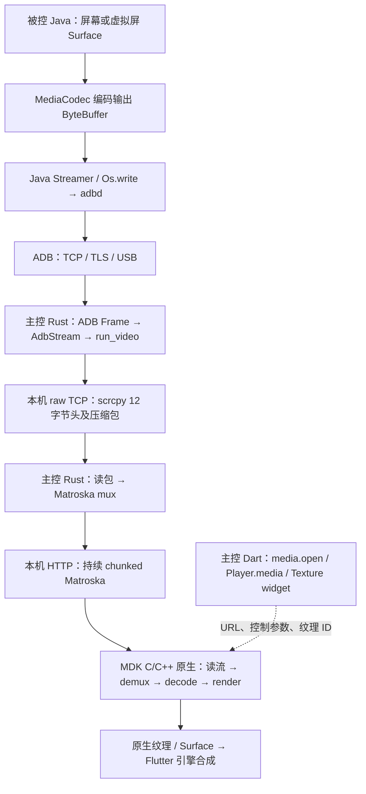

# scrcpy 到 fvp 的视频数据路径与复制边界

核查日期：2026-10-23。来源为当前工作区（HEAD `1bbcbcd8eba368e3c361f3e05aaff780733f039e` 加已有未提交改动）、固定依赖源码和官方资料。本次仅静态调研，未修改业务代码、启动被控服务或采集性能样本。当前所有权规范仍以[架构](../implementation/architecture.md)为准。

## 结论与计数口径

视频主通路是被控 Java 编码、ADB 传输、主控 Rust 接收与封装、MDK 原生解封装/解码、Flutter 原生纹理合成。Dart 负责请求、URL、播放器状态和纹理 ID，不承载连续压缩帧或逐帧原始像素。

当前链路有两段本机 TCP：`run_video → Rust media relay` 和 `Rust HTTP relay → MDK`。按默认 H.264 的稳定播放路径，从主控 ADB payload 已进入内存起，能确认至少 **5 个按压缩包大小复制数据的 Rust 用户态阶段**。这不包含 socket 用户态/内核态搬运、USB/TLS 适配、被控 adbd、MDK 内部和 GPU 工作，也不是“整条链路只有 5 次 memcpy”。

这里的“一阶段”指一份包的有效媒体数据被复制到另一份缓冲；一个阶段可能按 ADB 分片、NAL 或行执行多次复制调用。容器头、URL、PTS 等小型控制信息另计。编译器优化、内存分配器重分配、驱动实现与硬件 DMA 的实际内存访问次数不在静态源码计数范围内。

## 数据流与语言边界

### 被控 Java：Surface 编码，压缩输出直接写 socket

当前打包的是源码构建、core-library desugared 的 scrcpy 5.0.1 JAR；manifest 固定 commit `a60891aea193d92e7e5c3942700eca63f9d19a5f`，注明 Java 源码未修改。它不是直接打包官方 release JAR。[产物身份](../../servers/vendor/manifest.json#L53)

`SurfaceEncoder` 将 `createInputSurface()` 的 Surface 交给捕获端，随后从 `getOutputBuffer()` 取得压缩输出，直接传给 `Streamer.writePacket()`。Streamer 先独立写 12 字节 PTS/flags/length，再写原 ByteBuffer；写完才释放 MediaCodec output buffer。视频分支没有先读入 Java `byte[]` 再拼接的步骤。[Surface 输入](https://github.com/Genymobile/scrcpy/blob/a60891aea193d92e7e5c3942700eca63f9d19a5f/server/src/main/java/com/genymobile/scrcpy/video/SurfaceEncoder.java#L127-L149)、[编码输出发送](https://github.com/Genymobile/scrcpy/blob/a60891aea193d92e7e5c3942700eca63f9d19a5f/server/src/main/java/com/genymobile/scrcpy/video/SurfaceEncoder.java#L252-L275)、[Streamer](https://github.com/Genymobile/scrcpy/blob/a60891aea193d92e7e5c3942700eca63f9d19a5f/server/src/main/java/com/genymobile/scrcpy/device/Streamer.java#L68-L124)

`IO.writeFully` 调用 `Os.write(fd, ByteBuffer)`，视频 fd 来自 LocalSocket。可确认 scrcpy Java 层没有额外的逐包 payload 副本；MediaCodec、系统调用、adbd 与驱动内部仍可能复制。Android 文档的 Surface/ByteBuffer 接口本身不保证全链路物理零拷贝。[IO](https://github.com/Genymobile/scrcpy/blob/a60891aea193d92e7e5c3942700eca63f9d19a5f/server/src/main/java/com/genymobile/scrcpy/util/IO.java#L22-L59)、[LocalSocket](https://github.com/Genymobile/scrcpy/blob/a60891aea193d92e7e5c3942700eca63f9d19a5f/server/src/main/java/com/genymobile/scrcpy/device/DesktopConnection.java#L31-L84)、[MediaCodec API](https://developer.android.com/reference/android/media/MediaCodec#getOutputBuffer(int))

实际启动参数启用 `send_stream_meta=true`、`send_frame_meta=true`，Rust 自己通过 ADB `localabstract:scrcpy_<scid>` 打开视频与控制流。5.0.1 的 12 字节 session 尺寸元数据与普通 packet header 需分别解析；不是每个 12 字节单元后都有压缩 payload。[启动参数](../../crates/interop_core/src/scrcpy.rs#L841)、[ADB 接入](../../crates/interop_core/src/scrcpy.rs#L927)、[session 头判断](../../crates/interop_core/src/scrcpy.rs#L2428)

### 主控 Rust：5 个明确复制阶段

| 阶段 | 数据从哪里到哪里 | 确认证据 |
| --- | --- | --- |
| 1 | ADB Frame payload → `run_video` 的完整 scrcpy 包 `Vec` | `AdbStream::read` 的 `copy_from_slice`；`run_video` 分配 `vec![0; length]` 后 `read_exact` |
| 2 | HTTP relay 收到的编码包 → codec repack 输出 `Vec` | H.264/H.265 将 Annex B 起始码改为 NAL 长度前缀，并 `extend_from_slice(nal)` |
| 3 | repack 输出 `data` → Matroska `SimpleBlock` 的 `block` | `block.extend_from_slice(&data)` |
| 4 | `SimpleBlock` → EBML writer 的 `working_buffer` | 固定 `ebml-iterable 0.7.1` 的 `write_binary_tag` 复制整个 binary data |
| 5 | EBML `working_buffer` → writer 的目标 `Vec<u8>` | `private_flush` 对目标 `Vec` 执行 `write_all`；Vec 的 Write 实现追加并复制字节 |

阶段 1 的[流读取](../../crates/adb/src/client.rs#L1280)与[完整包分配](../../crates/interop_core/src/scrcpy.rs#L2648)；阶段 2 的[codec repack](../../crates/interop_core/src/media/codec.rs#L103)；阶段 3 的[SimpleBlock](../../crates/interop_core/src/media/matroska.rs#L155)；阶段 4 的[固定 EBML binary writer](https://github.com/austinleroy/ebml-iterable/blob/1e7cf300fc4023fe79f11568a8bb9d8eb1c8adbd/src/tag_writer.rs#L258-L270)；阶段 5 的[固定 writer flush](https://github.com/austinleroy/ebml-iterable/blob/1e7cf300fc4023fe79f11568a8bb9d8eb1c8adbd/src/tag_writer.rs#L145-L147)与[Rust Vec Write 契约](https://doc.rust-lang.org/std/io/trait.Write.html#impl-Write-for-Vec%3Cu8,+A%3E)。Cargo.lock 固定 webm-iterable/ebml-iterable 均为 0.7.1；缓存的 EBML `.cargo_vcs_info.json` 对应上述 commit。

阶段 1 之后还有一次 raw loopback 写出和读入；阶段 5 之后还有一次 HTTP loopback 写出和 MDK 读入。`read_unit` 再次为压缩包分配 `Vec` 并从 socket 读入。它们产生额外 I/O、缓冲和调度，未混入上述 5 个纯用户态复制阶段，也未将 `read_exact` 的分片重试误算为重复复制整个包。[raw 输出](../../crates/interop_core/src/scrcpy.rs#L2742)、[relay 连接 raw 端口](../../crates/interop_core/src/media/http.rs#L351)、[relay 读包](../../crates/interop_core/src/media/http.rs#L285)、[HTTP chunk 写入](../../crates/interop_core/src/media/http.rs#L322)

下列操作本身没有复制整份 payload：ADB reader 把 `frame.payload` 的所有权移入队列；消费者把 `bytes.bytes` 移入 `self.buffer`；Annex B 扫描生成借用切片；mux 最终用 `std::mem::take` 移出目标 Vec；HTTP chunk 将长度行、body、CRLF 分别写出，不先把三者拼入另一份完整 body。[ADB 队列](../../crates/adb/src/client.rs#L576)、[接收所有权](../../crates/adb/src/client.rs#L1331)、[NAL 借用](../../crates/interop_core/src/media/codec.rs#L234)、[mux 输出](../../crates/interop_core/src/media/matroska.rs#L161)、[chunk](../../crates/interop_core/src/media/http.rs#L322)

这里没有视频重编码。Rust 重写包格式、PTS 和容器，MDK 再解封装并解码。AV1/VP8/VP9 也会生成 repack Vec；AV1 必要时另补 sequence，不能把 H.264 的 NAL 转换细节套给所有 codec。[各 codec 分支](../../crates/interop_core/src/media/codec.rs#L127)

### USB 与 TLS 会增加计数边界

Android USB 的 Kotlin 只交接已授权 `UsbDeviceConnection.fileDescriptor` 等元数据；Rust 复制 fd 并交给 nusb。连续 USB 视频不经 Kotlin→Dart 逐包回传。[Kotlin fd 交接](../../app/android/app/src/main/kotlin/dev/scrcpyconnect/scrcpy_connect/MainActivity.kt#L237)、[Rust fd 导入](../../crates/interop_core/src/device.rs#L1747)

但当前 Rust USB 接收适配在 ADB Frame 解析前，又经过 `nusb reader → 64 KiB 临时 buffer → tokio duplex buffer → ADB Frame payload`。固定 nusb 0.2.8 的 `EndpointRead::poll_read` 使用 `ReadBuf::put_slice`；tokio 1.53.3 duplex 写入 `extend_from_slice`，读出再 `put_slice`。因此 USB 路径在上述基线前，另可辨认 **3 个用户态复制阶段**，合计至少 8 个；不包含 USB 驱动等更低层处理，也不能把双向适配中发送方向的代码再计入视频接收。[本项目 USB 适配](../../crates/adb/src/usb.rs#L237)、[nusb 固定源码](https://docs.rs/crate/nusb/0.2.8/source/src/io/read.rs)、[tokio 固定源码](https://docs.rs/crate/tokio/1.53.3/source/src/io/util/mem.rs)

TCP 与已协商 TLS 的路径还需区分。TLS 可能增加加解密缓冲及复制；不以普通 TCP 的 5 阶段基线充当 TLS 全链路总数。被控 Android/adbd 版本未由项目统一固定，同样无法只从 scrcpy Java 源码推出 adbd 的精确复制数。

### 主控 Dart 与 fvp 原生：连续播放只传控制信息

Dart 的 `PortableVideoOutputs` 发送 `media.open(port, token, codec, generation)`，获取 Rust 返回的 HTTP endpoint，然后把 URL 交给 `FvpVideoPlayer.open()`；后者设置 `_player.media = url`、`prepare()`、`updateTexture()`。[Dart 请求](../../packages/interop_bridge/lib/src/media/portable_video.dart#L88)、[打开 URL](../../packages/interop_bridge/lib/src/media/portable_video.dart#L165)、[fvp 接口](../../packages/interop_bridge/lib/src/media/fvp_video_player.dart#L188)

固定 fvp 0.39.1 的 `Player.media` 将 URL 做 `toNativeUtf8()`，通过 C FFI `setMedia` 传给 MDK，随后释放临时字符串。`CreateRT` MethodChannel 只携带原生 Player 地址、尺寸与 tunnel 参数；像素不随它逐帧发送。最终应用使用 `Texture(textureId: texture)`；Flutter 的 Texture 按整数 ID 引用后端纹理，可由后端自主更新而无需逐帧执行 Dart。[fvp Player](https://github.com/wang-bin/fvp/blob/v0.39.1/lib/src/player.dart)、[fvp MethodChannel](https://github.com/wang-bin/fvp/blob/v0.39.1/lib/src/fvp_method_channel.dart)、[fvp 设计](https://github.com/wang-bin/fvp#design)、[Flutter Texture](https://api.flutter.dev/flutter/widgets/Texture-class.html)

项目显式指定 `avformat.input=matroska` 等输入属性，MDK 在原生侧读 HTTP、demux、解码与渲染。其 SDK 实现以二进制分发，无法从公开接口精确数出 IO、demux、packet、解码输入缓冲的复制数。fvp Dart 包版本也不逐字节锁定所有平台 MDK SDK。[输入设置](../../packages/interop_bridge/lib/src/media/fvp_video_player.dart#L57)、[依赖边界](../implementation/repository-tooling.md#社区原版-fvp-0391)

### 解码后像素：需区分 CPU 搬运与 GPU 工作

Android 当前 `updateTexture()` 未传 `tunnel`，fvp 默认 false，实际走 `updateNativeSurface`。fvp 中另有 `tunnel=true` 的 direct decoder Surface 路径及“no GPU copy”注释，不能把该注释用于当前默认分支。插件在当前 manifest 没有显式 `EnableImpeller` 元数据的配置下选择 SurfaceTexture 分支；这不等同于判断 Flutter Engine 自身一定使用哪种 renderer。[fvp Android JNI](https://github.com/wang-bin/fvp/blob/v0.39.1/android/fvp_plugin.cpp#L89-L103)、[Android 插件](https://github.com/wang-bin/fvp/blob/v0.39.1/android/src/main/java/com/mediadevkit/fvp/FvpPlugin.java)

| 主控平台 | 固定 fvp 源码可见工作 | 可以得出的复制结论 |
| --- | --- | --- |
| Android | MDK 渲染至 Flutter Surface | 插件没有可见逐帧 CPU 像素 memcpy；MDK/GPU/驱动内部未知 |
| Linux | MDK 渲染到交给 Flutter 的 GL texture/FBO | 插件未显示额外 full-texture copy；内部未知 |
| Windows | MDK render target → Flutter 共享纹理 | descriptor callback 有 D3D11 `CopyResource` GPU 全纹理复制 |
| iOS/macOS | MDK render texture → IOSurface/CVPixelBuffer 对应纹理 | `copyPixelBuffer` 有 Metal blit GPU 全纹理复制；retain 本身不复制像素 |

平台证据：[Linux](https://github.com/wang-bin/fvp/blob/v0.39.1/linux/fvp_plugin.cc#L125-L169)、[Windows](https://github.com/wang-bin/fvp/blob/v0.39.1/windows/fvp_plugin.cpp#L57-L78)、[Apple](https://github.com/wang-bin/fvp/blob/v0.39.1/darwin/Classes/FvpPlugin.mm#L72-L105)。实际设备是否额外做色彩转换、纹理上传或 GPU 中转，以及其耗时，仍需运行态验证。

当前 MDK 官方 AMediaCodec 文档描述默认 Surface 输出与不拷到 host memory 的选项。它表达后端设计与参数语义，不能证明本机 SDK、实际所选解码器和厂商驱动全链路零拷贝。[MDK Decoders](https://github.com/wang-bin/mdk-sdk/wiki/Decoders#amediacodec)

## 启动、恢复与截图的额外回读

正常连续呈现不逐帧把 RGBA 交给 Dart，但生产启动和恢复会调用 `_verifyFrame`，进行 `32×32` 像素回读以验证画面；手动截图则按实际请求尺寸回读。当前走项目自有 `NativeVideoReadback`，不能用 fvp 未采用的 public snapshot 实现计数。[启动验证](../../packages/interop_bridge/lib/src/media/portable_video.dart#L178)、[验证尺寸](../../packages/interop_bridge/lib/src/media/portable_video.dart#L396)、[snapshot 分支](../../packages/interop_bridge/lib/src/media/fvp_video_player.dart#L270)

MDK 提供 CPU 可读 snapshot 后，可确认有 3 次完整请求图像的复制：MDK callback pixels → Rust Vec（逐行 `copy_nonoverlapping`）；Rust Vec → Dart 申请的 calloc FFI 内存；该内存视图 → `Uint8List.fromList` 的 Dart 堆数组。`asTypedList` 本身只是视图。MDK/GPU 产生这份 CPU snapshot 的回读或转换另计。[Rust callback 复制](../../crates/interop_bridge/src/media_trace.rs#L466)、[Rust 输出复制](../../crates/interop_bridge/src/media_trace.rs#L740)、[Dart 堆复制](../../packages/interop_bridge/lib/src/media/native_video_readback.dart#L109)

一次成功的 32×32 RGBA 验证图像是 4096 字节，三阶段约复制 12 KiB；验证可能重试，但不是按每个呈现帧固定回读全幅画面。手动截图还涉及 PNG 编码等后续处理，不并入连续压缩流基线。逐帧 trace、PacketArchive 为显式诊断能力，默认播放未开启；启用 packet archive 时 `append` 还会复制已输出的 Matroska 数据。[PacketArchive](../../crates/interop_core/src/media/packet_archive.rs#L95)、[默认 trace 配置](../../packages/interop_bridge/lib/src/media/fvp_video_player.dart#L19)、[普通 media.open 参数](../../packages/interop_bridge/lib/src/media/portable_video.dart#L88)

## 成本判断与后续可验证问题

上述 5 阶段搬运的是压缩码流。以默认目标码率 4 Mbps 为例，码流量约 0.5 MB/s，5 轮对应约 2.5 MB/s 被复制的数据，读写合计内存流量粗算约 5 MB/s。实际 VBR、I 帧峰值、分配、系统调用与线程调度另算；这是数量级估算，不是运行结果。[产品默认参数](../../packages/interop_bridge/lib/src/application_settings.dart#L13)

源码能够证明有优化空间，不能证明它当前主导延迟。候选应分开验证：合并 raw TCP 中转可减少一段 loopback 与中转任务；减少 mux 临时 Vec 可减少纯用户态复制；改 MDK 输入方式可改变 HTTP 边界，但须重新核对内存所有权、背压与取消。仅替换 fvp 为 media_kit，若沿用相同 Rust/Matroska/HTTP 输入，上述 Rust 复制仍会保留。

既有[MDK 内存输入实验](mdk-memory-input-experiment.md)曾在指定 Android AVD、相同录像与节拍下比较 HTTP/append，没有观察到明显输入到解码延迟或 CPU 收益；该实验未覆盖当前真实 ADB 全链路、所有设备与物理显示。它限制了“去 HTTP 就必然大幅降延迟”的推论，不能替代本次链路的设备采样。
